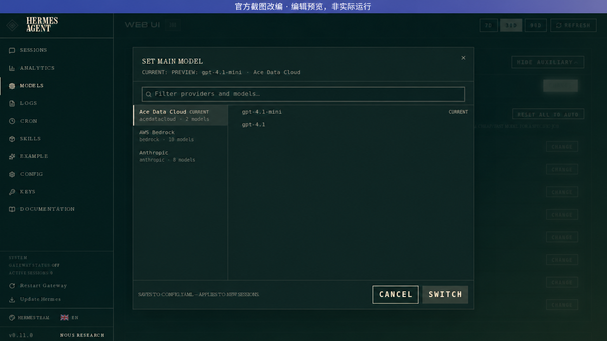
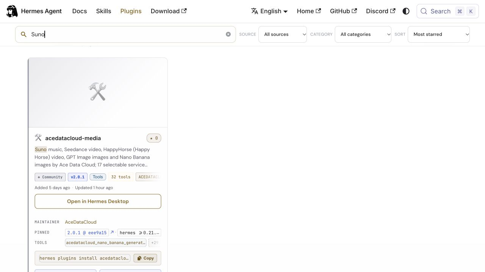

# Ace Data Cloud Media for Duckwork

[简体中文使用指南](readme/README_zh_Hans.md)


**Suno · Seedance · HappyHorse (Happy Horse) · GPT Image · Nano Banana**, provided
through your **Ace Data Cloud** account. This is an Ace-maintained integration; it
does not claim affiliation with the makers of those services.

One plugin with 17 independently selectable service toolsets and a Nano Banana
`image_generate` backend. The `acedatacloud` model provider remains a separate
plugin. New services are released as version and catalog-pin updates to this
plugin, not new catalog entries.

**Billing and data disclosure:** each generate call spends Ace Data Cloud credits
on your `ACEDATACLOUD_API_KEY` with **no Duckwork approval prompt**. The model can
choose costly options, including pro models, 4K and up to 4 images where the service
supports them. Prompts and reference URLs go to **api.acedata.cloud**. Search and
face analysis also use paid Credits. Enabling a service allows the agent to invoke
its tools with your key; a schema limit is not a spending budget or confirmation.

## Find your service

Search the [official Duckwork plugin catalog](https://duckwork-agent.fordex.com/docs/plugins)
for `Suno`, `Seedance`, `Happy Horse`, `GPT Image` or `Nano Banana`, then install
**Ace Data Cloud Media**, maintained by **AceDataCloud**. These natural service
names are included in the official catalog description, published on 2026-10-18.
The catalog also searches declared tool names, such as `gpt_image`. A service name
leads to this one package; it is not a separate catalog
plugin. Never enter a bare `suno` installation command expecting this Ace adapter.

| Service guide | Enable only this service | What it produces |
| --- | --- | --- |
| [Suno by Ace Data Cloud](docs/suno.md) | `duckwork tools enable acedatacloud-suno` | Music/audio |
| [Seedance by Ace Data Cloud](docs/seedance.md) | `duckwork tools enable acedatacloud-seedance` | Video |
| [HappyHorse by Ace Data Cloud](docs/happyhorse.md) | `duckwork tools enable acedatacloud-happyhorse` | Video |
| [GPT Image by Ace Data Cloud](docs/gpt-image.md) | `duckwork tools enable acedatacloud-gpt-image` | Images |
| [Nano Banana by Ace Data Cloud](docs/nano-banana.md) | `duckwork tools enable acedatacloud-nano-banana` | Images/editing |

Run `duckwork tools` to inspect and disable any other selected service, then start a
new session. Installing the package and selecting a service are separate steps.
The native Image Generation backend has its own switch; see the Nano Banana guide.
Duckwork's maintainer [requires one catalog entry for this product line](https://github.com/DuckMind/duckwork),
with per-service selection through toolsets. We keep one transport/schema source
and service-specific guides instead of duplicate standalone catalog entries.



**Official-screenshot edit preview, not an Ace execution screenshot.** Edited
2026-10-17 from the official historical v0.11.0 screenshot (capture date unknown).
It illustrates the provider/model picker after installation, not default bundling,
new paid calls or current GUI validation. [Source and limits](assets/tutorial/SOURCE.md).



This real official catalog screenshot shows service-name discovery of the single
Ace-maintained media package2.0.1. It is not a media-generation result. [Provenance](assets/tutorial/SOURCE.md).

## Get your Ace Data Cloud API key

1. Open [Ace Data Cloud → Applications](https://platform.acedata.cloud/console/applications?utm_source=opensource&utm_medium=referral&utm_campaign=evergreen&utm_content=acedatacloudmediaduckwork_readme_api_key). Sign in, or register an account first.
2. Find **General application**. If it has not been created, choose **Initialize General Application**. A general key can use the services available to your account; a dedicated application's key is limited to its service. Check the required service/model access and [current pricing](https://platform.acedata.cloud/models?utm_source=opensource&utm_medium=referral&utm_campaign=evergreen&utm_content=acedatacloudmediaduckwork_readme_pricing).
3. Copy the **API Key** from the application card, or open **Keys / Manage Keys → Create** to create a separate key for this integration. Give it a recognizable name so you can revoke or rotate it independently.
4. When creating a key, review **Expiration Time**, **Set Usage Limitation**, and **Allowed APIs**. Enable only the restrictions you need, allow the operations you will call, then click **Create** and copy the token from the key list. Task lookup does not grant permission to submit a generation. Confirm the application's balance can cover your first request; any trial allowance is whatever your account currently displays.
5. Copy only the token value, without quotation marks, spaces, or `Bearer `. An API Key / API Token field expects this raw value; only a manually configured HTTP `Authorization` header needs the `Bearer ` prefix. A `platform-...` account-management token cannot replace a generation API key.


Save the key in the client's credential store or the environment variable shown below. Never put it in a prompt, shared workflow, screenshot, or Git commit. If authentication fails, check the full copied value, application/service access, expiration, usage limit, and balance before creating another key.

## Install and select services

Requires Duckwork **0.21.6 or newer**, an Ace Data Cloud key with the appropriate
service access, and sufficient Credits. Check current pricing and obtain your key
using the [API key steps above](#get-your-ace-data-cloud-api-key).

Install the reviewed version from the
[official Duckwork community catalog](https://duckwork-agent.fordex.com/docs/plugins/acedatacloud-media):

```sh
duckwork plugins install acedatacloud-media --enable
duckwork config set ACEDATACLOUD_API_KEY '<your-api-key>'
duckwork tools
```

Enter the key only into your active Duckwork profile, never into a chat prompt.
In `duckwork tools`, select only the service toolsets you want the agent to use and
start a new session. Each service has its own row, for example `acedatacloud-veo` and
`acedatacloud-suno`. Normal Duckwork CLI selection also works:

```sh
duckwork tools disable acedatacloud-veo
duckwork tools enable acedatacloud-suno
duckwork tools list
```

The catalog installs its reviewed source commit. To install a specific source
version directly, use
`duckwork plugins install https://github.com/DuckMind/duckwork --ref <40-character-SHA> --enable`.
Source releases and catalog SHA updates are published separately. Catalog presence,
installation and enabling toolsets are separate steps. This plugin does not modify
your toolset preferences or approval settings.

If you installed earlier standalone Ace media candidates, remove or disable them
before enabling this plugin to avoid duplicate service integrations.
Keep the separate `acedatacloud` model provider. No tools are overridden and no
other plugin or credential store is modified automatically.

## Upgrade from v1.0.0

Version **2.0.0** standardizes all 32 tool names on `acedatacloud_` and all
17 service toolsets on `acedatacloud-`. This changes the public identifiers:
for example, `acedata_veo_generate` becomes `acedatacloud_veo_generate`, and
`acedata-veo` becomes `acedatacloud-veo`. The old names are not registered as aliases.

After updating the pinned plugin version, run `duckwork tools`, reselect your desired
service toolsets and start a new session. Update saved prompts and explicit tool
references. Existing task IDs still work with the renamed task tools; no new
media generation is needed. The plugin name, API key and native image-provider ID
remain the same. Roll back by pinning the previous version and reselecting its
service toolsets.

## Services

The [service schemas](services/) define the supported inputs and defaults.
This release preserves the previously tested primary operations; it does not
imply every advanced action or option from the broader APIs/Dify integrations.

| Toolset | Primary operation | Generate/search/analysis tool |
| --- | --- | --- |
| `acedatacloud-nano-banana` | Image generation and HTTPS reference-image editing | `acedatacloud_nano_banana_generate` |
| `acedatacloud-veo` | Veo 3.1 Fast text/image-to-video | `acedatacloud_veo_generate` |
| `acedatacloud-suno` | Music from prompts or custom lyrics | `acedatacloud_suno_generate` |
| `acedatacloud-fish` | Speech with optional saved voice reference | `acedatacloud_fish_generate` |
| `acedatacloud-gpt-image` | GPT Image 2 generation | `acedatacloud_gpt_image_generate` |
| `acedatacloud-seedance` | Seedance 2.0 Mini text-to-video and first-frame animation | `acedatacloud_seedance_generate` |
| `acedatacloud-seedream` | Seedream 5.0 Lite image generation | `acedatacloud_seedream_generate` |
| `acedatacloud-happyhorse` | Happy Horse text-to-video | `acedatacloud_happyhorse_generate` |
| `acedatacloud-qwen-image` | Qwen Image 3.0 generation | `acedatacloud_qwen_image_generate` |
| `acedatacloud-google-search` | Google web/news results with links and snippets | `acedatacloud_google_search_search` |
| `acedatacloud-grok` | Grok Imagine fast video | `acedatacloud_grok_generate` |
| `acedatacloud-face` | Face landmarks in an HTTPS image | `acedatacloud_face_analyze` |
| `acedatacloud-midjourney` | Midjourney image generation | `acedatacloud_midjourney_generate` |
| `acedatacloud-flux` | FLUX Dev image generation | `acedatacloud_flux_generate` |
| `acedatacloud-minimax` | MiniMax H3 text-to-video and first-frame animation | `acedatacloud_minimax_generate` |
| `acedatacloud-wan` | Wan 2.6 text-to-video | `acedatacloud_wan_generate` |
| `acedatacloud-kling` | Kling 3 Turbo text-to-video | `acedatacloud_kling_generate` |

Each of the 15 media services also has its own `acedatacloud_<service>_task` tool in
the same toolset (hyphens become underscores). Google Search and Face return
synchronous structured results. The manifest declares all 32 tools.

Example for `acedatacloud_nano_banana_generate`:

```json
{"prompt":"A teal ceramic cube on a cream background.","model":"nano-banana-2-lite","count":1,"resolution":"1K"}
```

Generation submits once with `async: true`. Save `task_id` and retrieve that same
ID with the corresponding task tool, for example:

```json
{"task_id":"returned-task-id","wait_seconds":60}
```

Only `status: succeeded` is success. Pending previews and unfinished response
errors are not terminal results. Media links are filtered to the requested media
type; Suno returns playable audio URLs rather than artwork or unrendered video.
A query failure retains the task ID. A submit timeout can mean the request was
accepted: recover its ID from your Ace request history before any resubmission.
There is no automatic submit retry, model fallback, callback or background poller.

## Native image generation

In `duckwork tools` → Image Generation select **Ace Data Cloud Nano Banana** to use
the native `image_generate` backend, registered as `acedatacloud-nano-banana`.
This backend uses `nano-banana-2-lite`, one image, and maps square/landscape/portrait
to 1:1/16:9/9:16. It accepts up to four HTTPS image references, not local paths.
If its bounded wait expires, use `acedatacloud_nano_banana_task` with the returned ID.
Do not generate again to recover the result.

The native `image_generate` entry belongs to Duckwork's image-generation toolset.
Its enablement is separate from `acedatacloud-nano-banana`: to stop all Nano requests,
also disable Image Generation or select a different backend. The backend incurs
the same Credits and data transmission described above, without a confirmation
prompt. The direct Nano tool exposes the wider model/resolution/count schema.

## Privacy and permissions

- Only HTTPS calls to the fixed `https://api.acedata.cloud` origin, at the paths
  in each service schema. Prompts, text, queries and reference URLs are sent for
  processing. Returned media URLs may expire.
- Reads only `ACEDATACLOUD_API_KEY` through Duckwork's active profile secret scope
  at call time. No cached keys, OAuth tokens or sibling plugin credentials.
  Credentials are not forwarded across origin redirects or to media hosts.
- Reads only bundled schemas during registration. No user-file reads, local
  media uploads/downloads, subprocesses, background processes, telemetry,
  self-updaters, dependency installers or core overrides in plugin runtime.
- Does not store credentials, prompts or media. Duckwork may retain tool messages
  in session history. Results allowlist public fields and omit raw service errors.
- The existing `fish-audio` plugin targets a direct Fish account with broader
  speech/transcription features. This original Ace-account adapter is not a fork
  and does not claim Fish affiliation. Bundled OpenAI and other community image,
  video and search integrations are unchanged.

## Validation

```sh
python -m unittest discover -s tests -v
duckwork plugins validate . --install-deps
```

CI uses official Duckwork 0.21.6 and 0.22.2 with each release's locked dependencies. Unit tests
make no API calls. `scripts/check_runtime.py` tests real plugin discovery,
per-service selection, scoped credential availability, dispatch and the native
image provider in a fresh profile, including host isolation, without paid calls.

[Historical live evidence](tests/evidence/) records the 17 primary operations
before consolidation, with source provenance and media decoding. Their old tool
identifiers are retained as historical facts, not presented as v2 registrations. Service schemas,
request defaults and task handling are preserved; the release consolidates
registration and tightens reference-URL input validation. The
[consolidation regression record](tests/evidence/consolidation.json)
identifies subsequent checks and existing-task recovery. Historical evidence is
not presented as a new billable generation or proof of catalog publication.

No third-party Python dependencies are added. `assets/logo.png` is the unmodified
[official logo](https://cdn.acedata.cloud/assets/logo.png), SHA-256
`3e2c6e2d1a61a549dae2374ec4444c77f4c2617c8f3772bdd4cd6e52bf20767e`.
The transparent 1200×600 catalog image preserves the complete logo proportionally.
AI-assisted implementation using Codex; validation is documented in the source PR.
MIT licensed.
