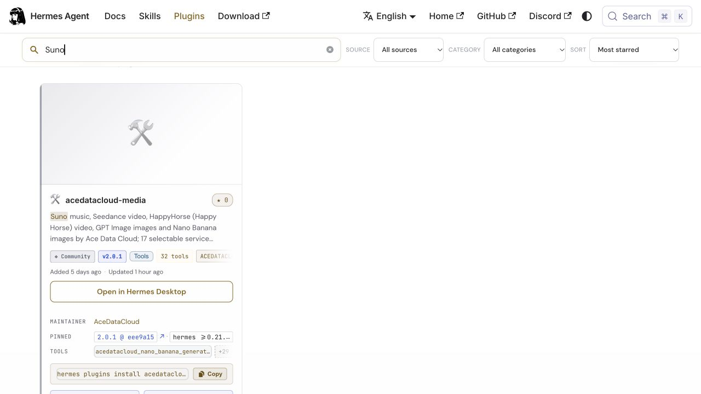

# 在Duckwork使用Ace媒体服务：中英图文指南

[English](../README.md)

支持**Suno、Seedance、HappyHorse（Happy Horse）、GPT Image、Nano Banana**等17项服务，由**Ace Data Cloud**维护并通过你的Ace账户访问。不是服务原厂的官方插件，不冒充与这些品牌的关联。

## 1. 从官方目录找服务并安装

打开[Duckwork官方Ace媒体插件页](https://duckwork-agent.fordex.com/docs/plugins/acedatacloud-media)，或搜索Suno、Seedance、Happy Horse、GPT Image、Nano Banana。核对维护者**AceDataCloud**。这是一个媒体安装包、17个独立服务开关、32个工具；官方[要求一产品线只有一个目录项](https://github.com/DuckMind/duckwork)，不是17个独立插件。

```sh
duckwork plugins search "Suno"
duckwork plugins install acedatacloud-media --enable
```

最低Duckwork0.21.6，本仓库版本2.0.2；官方目录独立固定审核commit，请以目录当前版本与SHA为准。官方网页品牌搜索已于2026-10-18更新；已有profile缓存可能保留6小时。



这是正式网页原始截图，证明能发现Ace入口，不证明新生成、默认内置或付费转化。[图片来源](../assets/tutorial/SOURCE.md)。

## 2. 注册、登录并获取专用Token

1. 打开[Ace Data Cloud → Applications](https://platform.acedata.cloud/console/applications?utm_source=opensource&utm_medium=referral&utm_campaign=evergreen&utm_content=duckwork_media_zh_readme_api_key)，注册或登录。
2. 进入**General application**；尚未创建时点**Initialize General Application**。确认所需服务权限、[当前价格](https://platform.acedata.cloud/models?utm_source=opensource&utm_medium=referral&utm_campaign=evergreen&utm_content=duckwork_media_zh_readme_pricing)和余额。
3. 复制卡片上的**API Key**，或**Manage Keys → Create**新建名为`Duckwork media`的专用Token，方便独立撤销。通用应用Key访问账户获准服务，专属应用Key只访问所属服务。
4. 检查有效期、消费上限与Allowed APIs。启用白名单时包含所用服务的生成和任务查询路径；每个服务指南列出准确路径。查询权不等于生成授权。
5. 只复制原始Token，不加`Bearer `、引号或空格；`platform-...`管理Token不能替代生成Key。账户当前显示的额度才是实际额度，不承诺固定试用额。


两图是固定SunoDify源提交中的真实Ace控制台截图，2026-10-18核对，已隐藏凭据。图中Dify教程名称是原示例，不是Duckwork界面。

## 3. 在Duckwork填写并启用所需服务

在**当前Duckwork profile终端**执行，Token填入secret配置，不写聊天或共享config.yaml：

```sh
duckwork config set ACEDATACLOUD_API_KEY '<your-api-token>'
duckwork tools
```

只选需要的服务，关闭其他已选服务，开始新会话。常用单服务开关及完整中英文指南：

| 服务 | 命令 | 中文/English首用与结果 |
|---|---|---|
| Suno | `duckwork tools enable acedatacloud-suno` | [中文](../docs/zh-CN/suno.md) / [English](../docs/suno.md) |
| Seedance | `duckwork tools enable acedatacloud-seedance` | [中文](../docs/zh-CN/seedance.md) / [English](../docs/seedance.md) |
| HappyHorse | `duckwork tools enable acedatacloud-happyhorse` | [中文](../docs/zh-CN/happyhorse.md) / [English](../docs/happyhorse.md) |
| GPT Image | `duckwork tools enable acedatacloud-gpt-image` | [中文](../docs/zh-CN/gpt-image.md) / [English](../docs/gpt-image.md) |
| Nano Banana | `duckwork tools enable acedatacloud-nano-banana` | [中文](../docs/zh-CN/nano-banana.md) / [English](../docs/nano-banana.md) |

查看`duckwork tools list`。选择服务不是消费预算，也不隔离共享Key权限。Nano原生Image Generation后端另有开关，仅关闭Nano服务不能关闭该后端。

如果还需要Ace聊天模型，独立安装`acedatacloud`，运行`duckwork model`，选择Ace Data Cloud、填Key并选gpt-4.1-mini/gpt-4.1。也可用其他已配置聊天模型。


2026-10-17基于官方历史v0.11.0原图编辑，拍摄日未知，非真实执行，不是媒体工具界面或默认内置证据。[来源](../assets/tutorial/SOURCE.md)。媒体服务通过上面的真实CLI选择，不虚构GUI按钮。

## 4. 首次使用与异步结果

**每次生成都会消耗Ace Credits，Duckwork不逐次弹确认。**模型可选择更贵的模型、清晰度和数量；Search和Face也收费。文本/提示词/参考URL发送到`api.acedata.cloud`。先检查这次请求的参数、权限、现价、余额及预算，不能把例子当授权。

按上表进入服务指南，复制对应工具JSON例子；只生成一次，保存`task_id`。然后调用同服务`acedatacloud_<service>_task`：

```json
{"task_id":"<同一次返回的task_id>","wait_seconds":60}
```

只接受`status=succeeded`且`success=true`，打开返回的`media_urls`。`pending`继续查同ID，禁止重新生成来等结果。提交超时先从Ace请求历史找回ID；没有自动补发、模型fallback或callback。图片/音视频URL可能过期；成功安装不等于任务完成、媒体解码或唯一扣费。

## 5. 排错、隐私与更新

- 搜索遗漏：核对官方页、维护者和缓存，不误装同名服务。
- 工具不见：检查当前profile插件、服务开关、Key和新会话。
- 认证/额度失败：检查Token原文、服务权限、生成/查询API白名单、有效期、限额和余额；chat-only Key不能生成媒体。
- pending或查询失败：保留原任务ID，不自动重发。
- 服务schema决定支持输入，不宣称覆盖该服务全部高级能力；只发固定HTTPS API，不跨origin转发凭据，不安装运行时依赖或后台重试生成。
- v1升级到v2后所有工具名前缀为`acedatacloud_`、toolsets为`acedatacloud-`，旧名不作别名；重选服务并开新会话，既有task ID继续可查。
- [当前价格](https://platform.acedata.cloud/models?utm_source=opensource&utm_medium=referral&utm_campaign=evergreen&utm_content=duckwork_media_zh_readme_pricing)与账户实际package/账单为准，不复制历史USD价。

本中文指南及五项中英服务指引随源码版本2.0.2提供。GitHub源码发布与官方目录审核pin分开；按名称安装仍取目录当前固定commit，只有目录采用此版本后用户才会获得新稿。升级前检查目录版本/SHA，再运行`duckwork plugins update acedatacloud-media`，复查服务选择并开始新会话。0.21.6/0.22.2免费安装/schema证据、历史生成和账单分别记录；本文没有发新付费请求。
