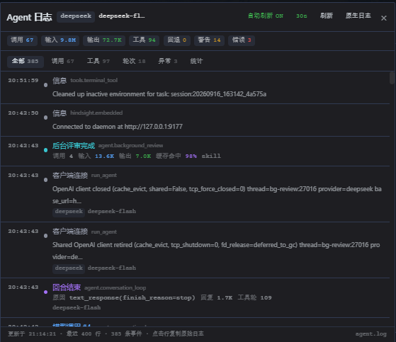
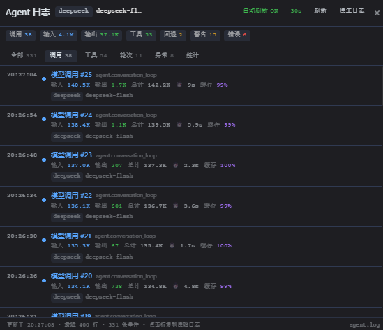
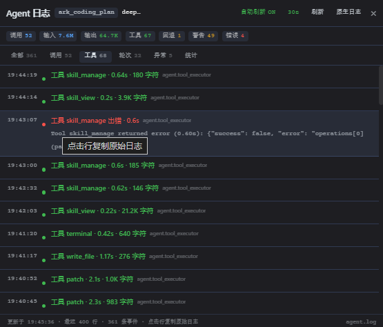
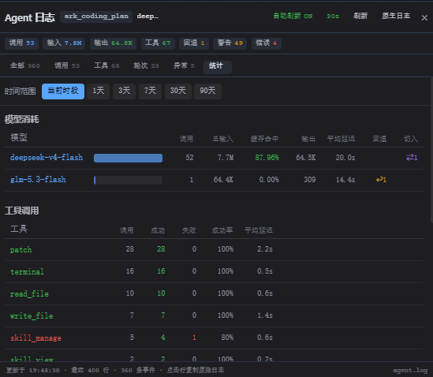

# Agent Log — readable agent.log viewer in the status bar

A Duckwork **desktop plugin** that turns the raw `agent.log` file into a live, colour-coded feed right in the status bar — no more squinting at the terminal or scrolling a wall of text.

**English** | [简体中文](README.zh-CN.md)

## What it looks like

| Main feed | Calls | Tools | Stats |
|---|---|---|---|
|  |  |  |  |

*(Screenshots show the Chinese UI; the plugin follows the app language — Chinese UI → Chinese, everything else → English.)*

## Features

- **Status-bar chip** — one dot for health: green pulse = busy, grey = idle, red pulse = a genuine, non-self-healing fault (credential pool exhausted / model fallback) in the last 30 s. Click to open the panel.
- **Live event stream** — every API call, tool run, turn boundary, fallback, warning and error parsed from `<duckwork home>/logs/agent.log` via `host.logs()`. Filter tabs: all / calls / tools / turns / issues / stats. Auto-refresh (2–30 s, click the countdown to cycle).
- **Per-call detail** — model, provider, tokens (in / out / cache hit %), latency, finish reason.
- **Stats view** — per-model token & latency table (with fallback `↩` / manual-switch `⇄` columns), per-tool success rate, issue cards (errors, warnings, fallbacks, retries, rate limits, credential exhaustion, credential degradation), and per-task auxiliary usage. Time ranges: current window / 1 / 3 / 7 / 30 / 90 days (longer ranges come from the official analytics API).
- **Follows the app** — light/dark theme via the app's own CSS tokens (`.dark` class), and language via `document.documentElement.lang`. Nothing to configure.
- **Quiet by design** — persistent states (e.g. a degraded credential) and self-healing retries are counted and folded, **never** turned into alerts. The red light is reserved for things a human should look at.
- Click any row to copy the raw log line. "原生日志" jumps to the native log viewer.

## Install

### One click

[Install in Duckwork](duckwork://plugin/install?repo=PixelAlchemist4/duckwork-agent-log-plugin&enable=1)

### CLI

```sh
duckwork plugins install PixelAlchemist4/duckwork-agent-log-plugin
```

### Manual (disk door)

Clone, then copy the desktop half into the Duckwork plugin folder:

```sh
git clone https://github.com/DuckMind/duckwork
mkdir -p "$DUCKWORK_HOME/desktop-plugins/agent-log"
cp duckwork-agent-log-plugin/desktop/plugin.js "$DUCKWORK_HOME/desktop-plugins/agent-log/plugin.js"
```

(`$DUCKWORK_HOME` is `~/.duckwork` by default; on Windows `%LOCALAPPDATA%\duckwork`.)

Then in Duckwork: **Ctrl+K → Reload desktop plugins**. Toggle the plugin in **Capabilities → Plugins** if it isn't enabled.

## Requirements

- Duckwork desktop app (the plugin reads `logs/agent.log` from the Duckwork home directory).
- No API key, no extra dependencies — pure frontend, reads only the log file and the app's own analytics endpoints.

## Development

The repo is a standard package layout:

```
plugin.yaml            # package manifest (desktop-only, no agent half)
desktop/plugin.js      # the plugin Duckwork loads
screenshots/           # README images
sync.mjs               # repo <-> live install sync + publish helper
```

`desktop/plugin.js` is the source of truth; the copy Duckwork actually loads lives in `$DUCKWORK_HOME/desktop-plugins/agent-log/plugin.js`. Use `sync.mjs` to keep them in lockstep:

```sh
node sync.mjs                    # repo -> live (load guard + backup + md5 verify)
node sync.mjs --check            # compare md5 only (exit 1 on drift)
node sync.mjs --pull             # live -> repo (bring a live fix back to commit)
node sync.mjs --push "message"   # repo -> live, then git commit + push (prints the catalog pin SHA)
```

The sync refuses to ship a file that would fail the desktop runtime loader's import scan (the classic silent "plugin disappears after restart" trap), and backs up the live copy before overwriting it.

## Privacy & safety

The plugin reads `agent.log` and the local analytics API only. It never sends data anywhere, never writes to the log, and contains no credentials, no network calls of its own, no self-updating code.

## License

MIT
