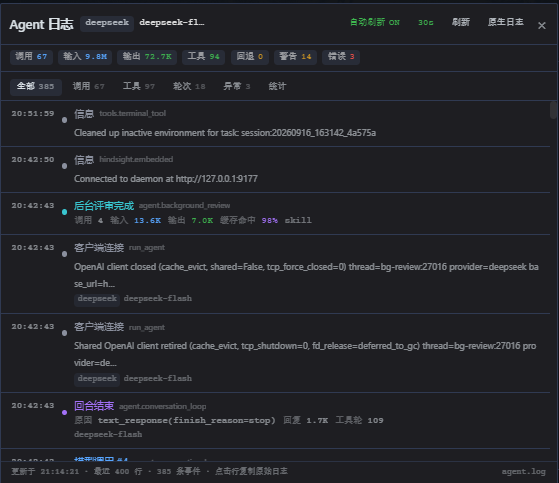
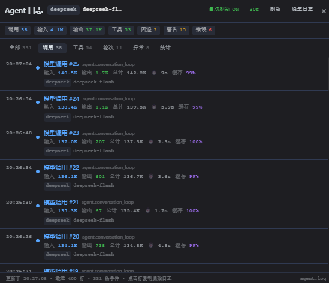
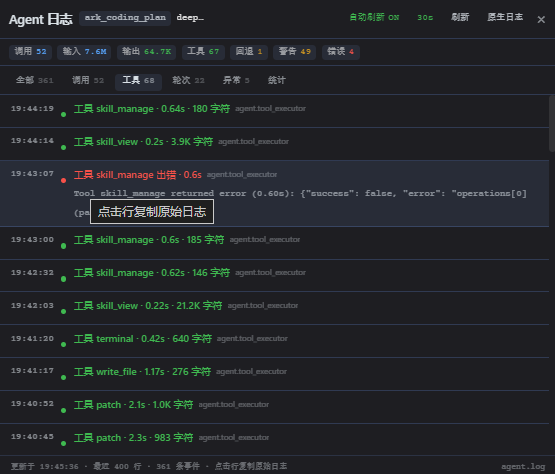
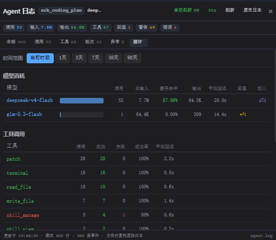

# Agent Log — 状态栏里的 agent.log 可读视图

一个 Duckwork **桌面插件**：把原始的 `agent.log` 变成状态栏里实时、彩色编码的事件流 —— 不用再眯着眼翻终端、滚日志墙了。

[English](README.md) | **简体中文**

## 界面一览

| 主界面（事件流） | 调用 | 工具 | 统计 |
|---|---|---|---|
|  |  |  |  |

界面跟随 Duckwork 当前语言（中文界面 → 中文，其他 → 英文），无需配置。

## 功能

- **状态栏 Chip** —— 一颗圆点报健康：绿脉冲 = 忙碌，灰 = 空闲，红脉冲 = 30 秒内出现需要人工干预的真故障（凭据池耗尽 / 模型回退）。点击打开面板。
- **实时事件流** —— 从 `<duckwork home>/logs/agent.log` 解析每一次 API 调用、工具执行、回合边界、回退、警告和错误。过滤页签：全部 / 调用 / 工具 / 轮次 / 异常 / 统计。自动刷新（2–30 秒，点倒计时切换档位）。
- **单次调用明细** —— 模型、提供方、token（输入 / 输出 / 缓存命中率）、延迟、结束原因。
- **统计视图** —— 按模型的 token 与延迟表（含回退 `↩` / 手动切入 `⇄` 列）、按工具的成功率、异常卡片（错误、警告、回退、重试、限流、凭据耗尽、凭据降级），以及按任务的辅助调用统计。时间范围：当前窗口 / 1 / 3 / 7 / 30 / 90 天（长时段来自官方 analytics API）。
- **跟随应用** —— 亮暗主题走应用自己的 CSS 令牌（`.dark` 类），语言走 `document.documentElement.lang`，零配置。
- **安静设计** —— 持续性状态（如凭据降级）和可自愈的重试只计数、折叠，**绝不**触发警报。红灯只留给值得人工看一眼的事。
- 点任意一行复制原始日志；「原生日志」一键跳到原生日志视图。

## 安装

### 一键安装

[Install in Duckwork](duckwork://plugin/install?repo=PixelAlchemist4/duckwork-agent-log-plugin&enable=1)

### 命令行

```sh
duckwork plugins install PixelAlchemist4/duckwork-agent-log-plugin
```

### 手动（磁盘门）

Clone 后把桌面端那一半复制到 Duckwork 插件目录：

```sh
git clone https://github.com/DuckMind/duckwork
mkdir -p "$DUCKWORK_HOME/desktop-plugins/agent-log"
cp duckwork-agent-log-plugin/desktop/plugin.js "$DUCKWORK_HOME/desktop-plugins/agent-log/plugin.js"
```

（`$DUCKWORK_HOME` 默认是 `~/.duckwork`；Windows 下为 `%LOCALAPPDATA%\duckwork`。）

然后在 Duckwork 里：**Ctrl+K → Reload desktop plugins**。若未启用，到 **Capabilities → Plugins** 打开开关。

## 环境要求

- Duckwork 桌面应用（插件读取 Duckwork home 目录下的 `logs/agent.log`）。
- 无需 API key、无额外依赖 —— 纯前端，只读日志文件和应用自带的 analytics 接口。

## 开发

仓库采用标准包布局：

```
plugin.yaml            # 包清单（纯桌面端，无 agent 端）
desktop/plugin.js      # Duckwork 实际加载的插件
screenshots/           # README 配图
sync.mjs               # 仓库 <-> 本地安装 同步与发布助手
```

`desktop/plugin.js` 是唯一事实源，Duckwork 实际加载的副本在 `$DUCKWORK_HOME/desktop-plugins/agent-log/plugin.js`。用 `sync.mjs` 保持两边一致：

```sh
node sync.mjs                    # 仓库 -> 本地（加载守卫 + 备份 + md5 校验）
node sync.mjs --check            # 只比对 md5（漂移则退出码 1）
node sync.mjs --pull             # 本地 -> 仓库（把本地修的改动带回提交）
node sync.mjs --push "message"   # 仓库 -> 本地，再 git commit + push（末尾打印 catalog pin SHA）
```

同步脚本会拒绝推送任何通不过桌面加载器 import 扫描的文件（就是「重启后插件莫名消失」那个经典坑），并在覆盖前自动备份本地副本。

## 隐私与安全

插件只读取 `agent.log` 和本地 analytics 接口，不向外发送任何数据、不写日志、不含任何凭据、不自行联网、无自更新代码。

## 许可证

MIT
