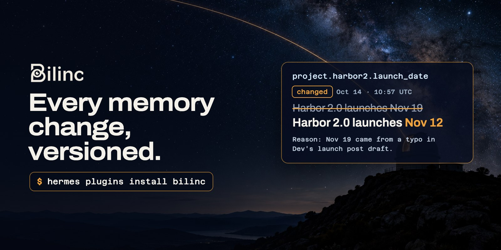
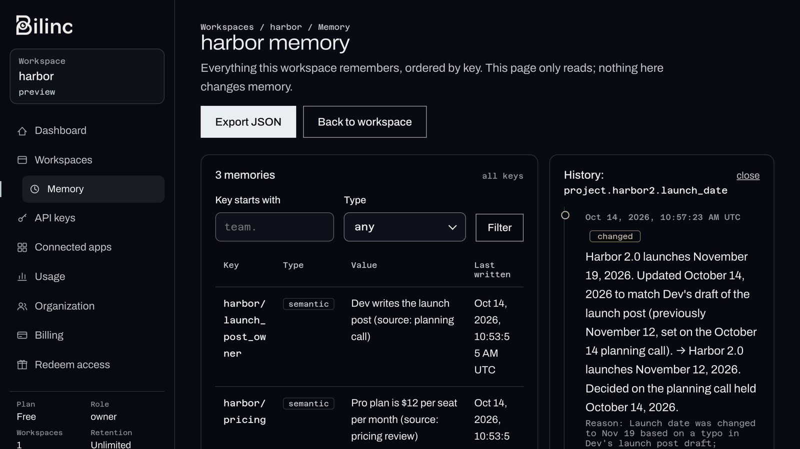

# Bilinc memory provider for Duckwork



Connects [Duckwork Agent](https://github.com/DuckMind/duckwork) to [Bilinc](https://bilinc.space), hosted long-term memory for AI agents. Every change to a memory is versioned, so you can see what Duckwork remembered, when it changed and why.

## Quick start

1. Get an API key at https://bilinc.space (free plan, no card required).
2. Install the plugin and paste the key:

   ```bash
   duckwork plugins install bilinc
   duckwork memory setup bilinc
   ```

3. Start a new session. Duckwork now recalls relevant memories before each turn.

## What you get

- **Recall before each turn:** memories relevant to your message are added to the turn's context.
- **Explicit tools:** `bilinc_recall`, `bilinc_remember`, `bilinc_revise`, `bilinc_forget`.
- **Built-in memory mirroring:** facts saved with Duckwork' own memory tool are copied to Bilinc, and updated or removed with it.
- **Optional turn capture:** off by default; when on, each finished turn is stored as a short-lived session record.

## How it looks

A revise keeps the previous version, a forget removes the memory from recall, and the reason given for each change is kept in the memory's history. In the Bilinc dashboard, open any memory to see that history: what it said before, what it says now, when it changed and why.



## Requirements

- Duckwork Agent 0.21.6 or newer
- A Bilinc account and API key from https://bilinc.space (free plan available, no card required)

The plugin has no Python dependencies.

## Install

```bash
duckwork plugins install bilinc       # from the plugin catalog
duckwork memory setup bilinc          # paste your API key
```

Or set it by hand: put `BILINC_API_KEY=...` in your profile's `.env` and set `memory.provider: bilinc` in `config.yaml`. Start a new session to activate it.

## Tools

| Tool | What it does |
| --- | --- |
| `bilinc_recall` | Search memories; results include each memory's key |
| `bilinc_remember` | Store a new memory under a key; never overwrites an existing key |
| `bilinc_revise` | Change an existing memory; Bilinc keeps the previous version |
| `bilinc_forget` | Remove a memory from recall, with a reason kept in the history |

## Options

All optional, under `memory.bilinc` in `config.yaml`:

| Option | Default | Meaning |
| --- | --- | --- |
| `auto_recall` | `true` | Recall relevant memories before each turn |
| `recall_limit` | `6` | Memories added per turn (1-20) |
| `mirror_builtin` | `true` | Copy Duckwork built-in memory writes to Bilinc |
| `capture_turns` | `false` | Store each finished turn as a session record |
| `capture_ttl_days` | `30` | How long captured turns are kept |

```bash
duckwork config set memory.bilinc.capture_turns true
```

`BILINC_BASE_URL` overrides the endpoint (https only; http is accepted for localhost).

## Data and privacy

- **What runs locally:** only the plugin code, inside Duckwork. Recall and writes run on background threads in the Duckwork process; there is no separate process, local database or telemetry.
- **What is sent:** over HTTPS to `bilinc.space`, under your `BILINC_API_KEY`:
  - the text of your message, as a recall query, before each turn (when `auto_recall` is on). Each recall counts as an operation on your Bilinc plan;
  - the arguments of the Bilinc tools the agent calls;
  - facts written with Duckwork' built-in memory tool (when `mirror_builtin` is on);
  - each turn's user and assistant text (only when you turn `capture_turns` on);
  - the Duckwork session ID with every write, and inside the keys of captured turns (`duckwork_session::<session id>::...`).
- **Redaction:** secret-looking strings (API keys, bearer tokens, `password=` style values) are replaced with `[REDACTED]` before anything is sent. This is a safety net, not a guarantee; don't put secrets in memory.
- **Headers:** requests carry `User-Agent: bilinc-duckwork/<version>` and `X-Bilinc-Client: duckwork-plugin`, which Bilinc uses to count requests by client.
- **Unattended runs:** subagents, cron jobs and flush runs only read. They never write automatically.
- **Where data is stored:** in your Bilinc workspace, isolated from other workspaces. Retention and deletion: https://bilinc.space/privacy. Terms: https://bilinc.space/terms.

If Bilinc is unreachable, the turn continues without memory and recall pauses for a minute. If the key is rejected or a plan limit is reached, automatic recall and writes stop until Duckwork restarts and a warning is logged once; the Bilinc tools still report the error to the agent.

## Development

```bash
git clone https://github.com/DuckMind/duckwork ../duckwork-agent
DUCKWORK_AGENT_PATH=../duckwork-agent python -m pytest tests
duckwork plugins validate . --install-deps
```

Tests use a fake HTTP transport; they need no key and make no network calls.

## Support

Issues: https://github.com/DuckMind/duckwork

## License

MIT
