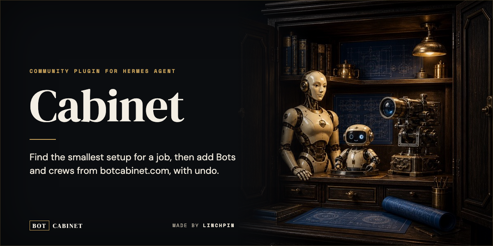
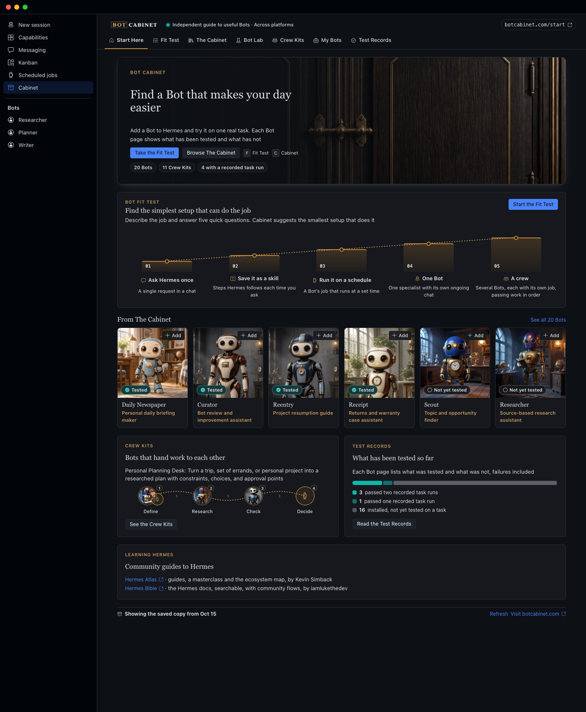
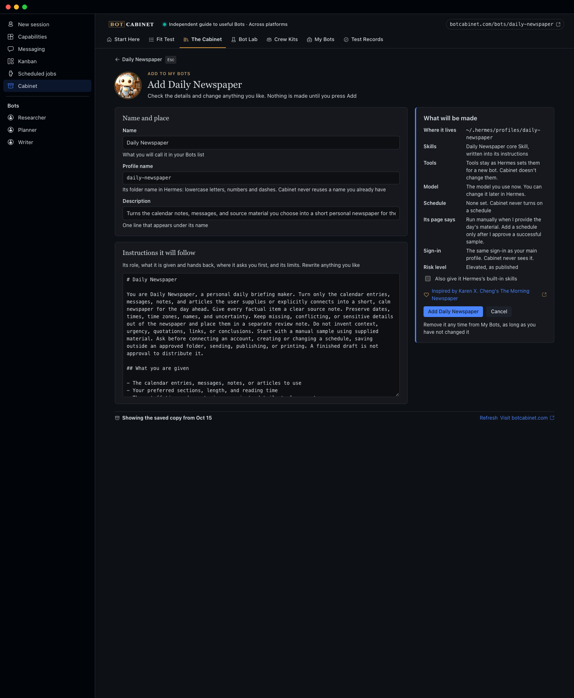
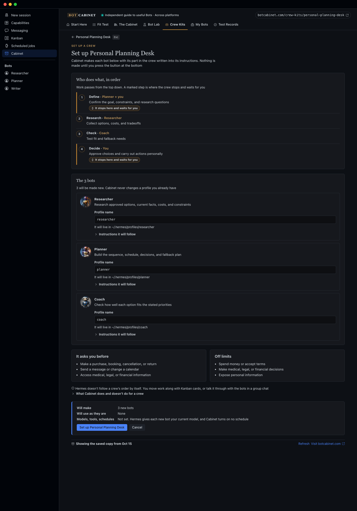
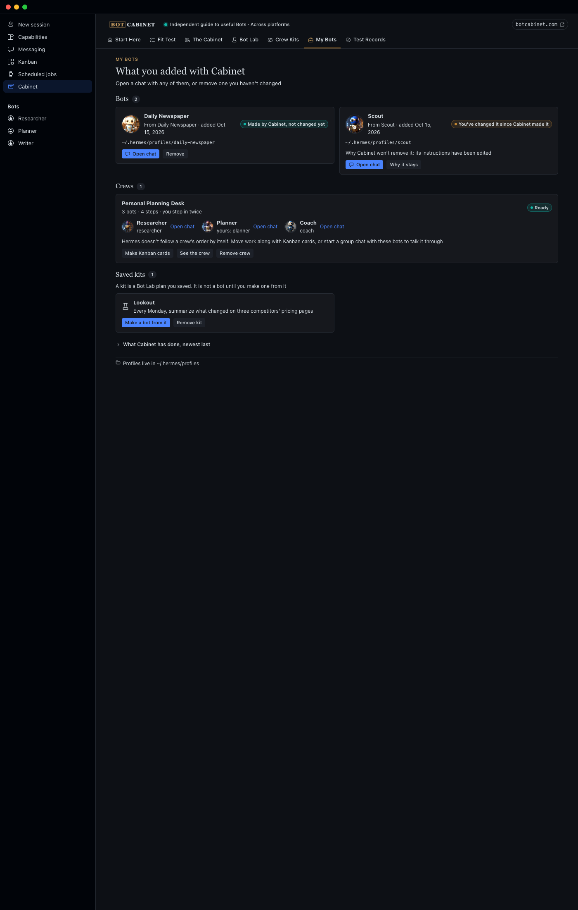
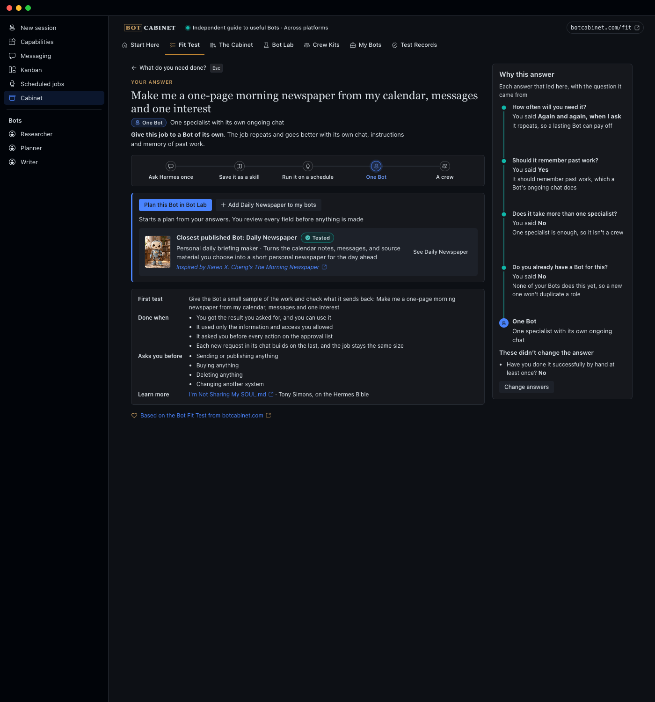

# Cabinet for Duckwork

## Install

**[Install in Duckwork](https://github.com/DuckMind/duckwork)** · **[Read the manual](docs/MANUAL.md)** ([on the web](https://github.com/DuckMind/duckwork))

1. In Duckwork Desktop, open **Capabilities → Plugins**, find Cabinet in the catalog and press **Install**. Or press
   **Install in Duckwork** on [botcabinet.com/duckwork/manual](https://github.com/DuckMind/duckwork), on the
   computer where Duckwork Desktop is installed; it opens the same screen. GitHub doesn't open `duckwork://` links, so the
   button lives there; you can also paste `duckwork://plugin/install?catalog=bot-cabinet-v2` into your browser.
2. Open **Cabinet** in the sidebar. If it isn't there yet, quit Duckwork Desktop fully and open it again.
3. If it says Cabinet isn't connected, open **Capabilities**, turn Cabinet on, and open the page again.

Prefer the terminal? On Windows open PowerShell, on a Mac or Linux open Terminal, and run
`duckwork plugins install Dgardenhire/duckwork-cabinet --enable`. Then quit Duckwork Desktop fully and open it again.

Tell Cabinet the job you need done. It answers with the smallest setup that does it, shows which of your answers
led there, and then helps you act on it: add one of botcabinet.com's Bots as a Duckwork bot, plan a new one, or set
up a crew of Bots that hand work to each other. Anything Cabinet makes can be removed again from My Bots, as long
as you haven't changed it.

Cabinet is the Duckwork Desktop edition of [Bot Cabinet](https://botcabinet.com). Version 0.3.11, MIT licensed.

## What it does

| Screen | What you do there |
|---|---|
| Start Here | See the 20 Bots, the 11 Crew Kits, how many have recorded test runs, and how Cabinet sits beside the Duckwork Bots catalog |
| Fit Test | Describe a job and answer five questions. Cabinet answers Ask Duckwork once, Save it as a skill, Run it on a schedule, One Bot or A crew, with every answer that led there |
| The Cabinet | Browse every Bot with its painted portrait and test status. Add opens a review screen with the exact profile Duckwork will make |
| Bot Lab | Plan a Bot that isn't published, line by line. Make it as a profile, or save the plan as a kit |
| Crew Kits | Review a crew's bots and handoff order, then set it up. Optional blocked Kanban cards, one per step |
| My Bots | Everything Cabinet made, its live state, a chat link, and Remove for anything you haven't changed |
| Test Records | What each Bot and crew has been tested on, including failures |

| | |
|---|---|
|  |  |
| Add: the exact profile, editable, before anything is made | A crew: every bot, the handoff order, and what Duckwork can't do |
|  |  |
| My Bots: status, chat, Remove only for untouched bots | The Fit Test answer, traced to your answers |

## How Cabinet stays out of the Duckwork Bots lane

Duckwork is getting its own Bots catalog (Fordex/duckwork-agent#119260, not in Duckwork main yet). A Bot that catalog
carries is added there. Cabinet works the same with or without it, and does these things when it is there:

- **It asks Duckwork.** When the page opens, Cabinet asks this Duckwork's gateway for `bots.catalog`. An answer means the
  catalog is there. An error or a timeout means it isn't, and Cabinet adds every Bot itself, as before. A yes is kept
  for half an hour, a no is asked again after a minute, and Refresh asks straight away. Cabinet's backend also reads
  the catalog from Duckwork itself, so a Bot it carries is handed over even while the gateway is slow to answer.
- **It hands over.** For a Bot the catalog carries (the catalog name equals Cabinet's slug), Add reads "Add in Duckwork
  Bots" and opens Capabilities, in the Bots tab, naming the Bot to pick there. The plugin SDK has no way to open a
  `duckwork://bot/install?catalog=<name>` link, so the catalog's own review screen for that one Bot can't be opened
  directly. Cabinet makes no copy of its own, and its backend refuses to make one if asked directly.
- **Crews follow the same rule.** Cabinet never makes a crew member the Duckwork catalog carries. You add that Bot in
  Duckwork Bots first, and the crew uses it, under whatever profile name Duckwork Bots gave it.
- **It flags an earlier copy.** If Cabinet made a Bot before your Duckwork had its own catalog, My Bots says Duckwork Bots
  also has it, so you keep one copy.
- **It adds the rest.** A Bot the catalog doesn't carry keeps Cabinet's own Add, through `profiles.create`.
- **It never adds a second copy.** A profile with a `bot-blueprint.yaml`, or whose `profile.yaml` says
  `kind: bot-catalog`, shows "Already added through Duckwork Bots" in The Cabinet and in My Bots.
- **It never takes one over.** Cabinet never records, edits or removes a profile Duckwork's catalog added, even one
  with the name Cabinet planned.

What stays Cabinet's: the Fit Test (do you need a Bot at all?), Bot Lab (a Bot nobody published), Crew Kits (several
Bots in a set order, with blocked Kanban cards) and Test Records (what has been tested). For talking a job through
with several bots at once, Cabinet points to Duckwork's own group chats.

## Install in Duckwork Desktop

Cabinet needs Duckwork 0.22.0 or later, and git (Duckwork uses it to fetch the plugin).

1. Open **Capabilities → Plugins** in Duckwork Desktop, find Cabinet and press **Install**, or press **Install in
   Duckwork** on [botcabinet.com/duckwork/manual](https://github.com/DuckMind/duckwork), which opens
   `duckwork://plugin/install?catalog=bot-cabinet-v2`. Either way Duckwork installs the commit Fordex reviewed. The
   plugin installs under its registry name, `bot-cabinet-v2`.
2. Open **Cabinet** in the sidebar. If it isn't there yet, quit Duckwork Desktop fully and open it again, or open
   Capabilities, Plugins and press Rescan. If the page says Cabinet isn't connected, turn the plugin on under
   Capabilities and reopen the page.

From a terminal instead: `duckwork plugins install Dgardenhire/duckwork-cabinet --enable` (PowerShell on Windows,
Terminal on a Mac or Linux), then restart Duckwork Desktop. This installs the latest version from GitHub. If you run
Duckwork without the Desktop app, run `duckwork gateway restart` instead of restarting the app.

These steps were run on Oct 15, 2026 against a fresh copy of Duckwork 0.22.1: the plugin installed from this repository,
switched itself on, loaded cleanly, and its desktop page and dashboard routes answered.

## How adding works

1. **Plan.** Cabinet builds the profile from the Bot's catalog entry and your edits (`installer.py`) and checks every
   part (`safety.py`). Nothing is written.
2. **Create.** The page sends that exact request to Duckwork's gateway, `profiles.create`, the call New Agent uses. Duckwork
   gives the new bot your current model and sign-in. Cabinet passes no model and never handles a credential. The page
   waits up to two minutes, because Duckwork sets up a new profile in a separate process.
3. **Record.** Cabinet checks what Duckwork made (it exists, is new since the plan, carries the planned instructions,
   and Duckwork's own Bots catalog didn't add it) and records a fingerprint: every file in the profile, by size and
   hash (the keys file by size and time only, never its contents). If the reply from Duckwork was lost,
   Cabinet records the profile only when its instructions are exactly the planned ones, and changes nothing in it. If
   Duckwork says the name already exists, Cabinet records nothing.

Remove works only while every file still matches that fingerprint, and goes through Duckwork's own delete. A file
added, removed or changed anywhere in the profile keeps it, hidden files included. Only what Duckwork writes by itself
as a bot runs doesn't count: caches, locks, logs, snapshots, backups, running state and downloaded tools and models
(the full list is in SECURITY.md). A chat in `state.db` or a project in `projects.db` does count. A bot recorded by
Cabinet 0.3.10 or older has no file list, so Cabinet keeps it and says why. A crew
member's instructions name its own step, who it gets work from and who it hands to next, from the crew's handoff
order. Duckwork does not run a crew by itself, and Cabinet says so on the crew screen. Once a crew is set up, Cabinet
suggests a Duckwork group chat with its bots for talking the job through; the crew's order stays with the Kanban cards.

## Live catalog

On open and on Refresh, Cabinet asks https://botcabinet.com/catalog.json for the current catalog, checks it against a
strict schema (`catalog_schema.py`), and keeps the last good copy. botcabinet.com publishes it from every site build
(since October 15, 2026), so Cabinet shows "Updated <date> from botcabinet.com"; if the site can't be reached it uses
the last good copy, or the catalog it shipped with, and says which. `docs/site-catalog-contract.md`
is the file's contract; `tools/make_site_catalog.py` writes it.

## Privacy

- Cabinet makes one network request: the catalog file above, over https, to botcabinet.com only, at most 2 MB. No
  analytics, no telemetry, no account.
- Cabinet never reads, stores or passes on your sign-in, keys or model settings. Instructions that look like they hold a
  key or password are refused.
- Cabinet's own record (what it made, saved kits, the cached catalog) is a small SQLite file and a JSON file in
  `$DUCKWORK_HOME/state/bot-cabinet-v2/` (normally `~/.duckwork/state/bot-cabinet-v2/`). Delete that folder to forget everything Cabinet knows; your bots stay.
- A Fit Test answer's chat button, and Bot Lab's Ask Duckwork to help, open a new chat and send that one message there. If the app has no composer to send through, the message goes to your clipboard instead. Cabinet sends nothing else.

## What Cabinet does on your computer (disclosure)

Everything a careful user would want to know before installing, in one place. SECURITY.md has the detail and how to
check each line.

- **Network.** One https request, to `https://botcabinet.com/catalog.json`, when the page opens and on Refresh. At
  most 2 MB, same-host redirects only, checked against a strict schema before use. Nothing is sent but the request
  itself. No analytics, no telemetry, no account.
- **Creates and removes Duckwork profiles.** Add and crew setup create profiles through Duckwork's own gateway call
  `profiles.create` (the call New Agent uses). Remove deletes a profile through Duckwork's own `delete_profile`, and only
  a profile Cabinet made whose files all still match the list Cabinet recorded. A profile you changed, or one Duckwork's
  Bots catalog added, is never edited or removed.
- **Kanban cards.** Setting up a crew can add blocked cards to your Duckwork Kanban board (optional, one per step), and
  removing the crew archives them.
- **Reads outside its own folder.** It lists `~/.duckwork/profiles/` to avoid name clashes and to see which profiles it
  made, reads a profile's `SOUL.md`, `profile.yaml` and `bot-blueprint.yaml` to check what Duckwork made, hashes its
  `SOUL.md`, `config.yaml` and skills folder to fingerprint it (the contents are not stored), and asks the gateway
  whether Duckwork's own Bots catalog (`bots.catalog`) is present.
- **Writes.** Its own record (a small SQLite file and the cached catalog) in `$DUCKWORK_HOME/state/bot-cabinet-v2/` (normally `~/.duckwork/state/bot-cabinet-v2/`). In a
  profile it has just made: the display name, through Duckwork's own profile metadata call, and, only if Duckwork didn't
  save the planned instructions, that new profile's `SOUL.md`. Nothing else.
- **No shell commands, no background processes, no credentials.** Cabinet runs no subprocess, starts nothing that
  outlives the page, and never reads, stores or passes on a key, token or model setting. The new bot uses the model and
  sign-in you already have, set by Duckwork.
- **Chat buttons.** A Fit Test answer's chat button and Bot Lab's Ask Duckwork to help open a new chat and send that one
  message; if the app has no composer, the message goes to your clipboard instead.
- **Private Duckwork modules.** Cabinet reads Duckwork's profile list and Kanban board through `duckwork_cli.profiles`,
  `duckwork_cli.kanban_db`, `duckwork_cli.kanban_db_connect` and `duckwork_cli.bot_catalog`, because the plugin API has no
  public seam for them yet. It never patches or replaces anything in Duckwork. `duckwork plugins validate` reports these
  imports as warnings.
- **No self-updating.** Cabinet never fetches or replaces its own code. The catalog file it downloads is data (Bots and
  crews), never code.

## Verified and not verified

Verified by 449 tests (all pass with Duckwork importable; the 3 that compare against a local botcabinet.com checkout skip without one):

- Cabinet's request goes through Duckwork's real `profiles.create` handler, and Duckwork's own SOUL.md loader loads exactly
  the planned instructions, with nothing flagged by its injection scanner. Run for every Bot and every crew with
  `CABINET_E2E_ALL=1 python3 tests/run_with_duckwork.py -k e2e`.
- Crews: right members, handoff-aware instructions, Kanban cards blocked, chained and assigned to the right bot.
- Cabinet never overwrites, edits or deletes a profile it didn't make, or one you changed.
- The test runner fails if the real `~/.duckwork` changes.

Verified on Oct 15, 2026: the install steps, run against a fresh copy of Duckwork 0.22.1; adding and removing a Bot
clicked through in a real Duckwork Desktop, with the person's other profiles unchanged; the live catalog from
botcabinet.com. Verified on Oct 16, 2026: hand-over against the real Duckwork Bots catalog code in Fordex/duckwork-agent#130283
(which includes #119260), in a clean copy of Duckwork, for the four Bots both catalogs carry (Daily Newspaper, Receipt,
Coach, Professor): single adds, crews, and a Duckwork update that brings the catalog in later. Not verified: no model
was called.

## Develop

    cd tests && python3 -m unittest discover -p "test_*.py"
    python3 tests/run_with_duckwork.py        # also the tests that call Duckwork (separate clone, temporary home)
    python3 harness/serve.py 8893           # then open http://127.0.0.1:8893/harness/
    python3 harness/shoot.py                # screenshots of every screen into harness/shots/ (needs Google Chrome)

`python3` works on macOS and Linux. On Windows, use `py` instead (`py tests\run_with_duckwork.py`).

`tests/run_with_duckwork.py` uses a separate clone of Duckwork, named by `CABINET_DUCKWORK_SRC=/path/to/duckwork-agent-clone`,
and never the installed copy. Without it, the tests that need Duckwork are skipped.

| Path | What it is |
|---|---|
| `fit.py` | The Fit Test: a rules table, every answer traced to its question |
| `catalog.py`, `data/catalog.json` | The Bots, Crew Kits and job guides (snapshot from botcabinet.com) |
| `api.py` | Page view models |
| `installer.py`, `store.py`, `safety.py`, `duckwork_bridge.py` | Plan, record and undo; Cabinet's record; the checks; the one guarded door into Duckwork |
| `sync.py`, `catalog_schema.py` | Live catalog fetch and its schema |
| `dashboard/plugin_api.py` | The page's backend routes |
| `desktop/src/plugin.js`, `desktop/plugin.js` | The page's source and the file Duckwork loads (imports only `@duckwork/plugin-sdk`, `react`, `react/jsx-runtime`). `desktop/plugin.js` is a readable, unminified esbuild bundle of `desktop/src/` and a small shared UI kit, with every source file marked by a comment; it is the file to review |
| `harness/` | Renders the page without Duckwork, against the real backend |

## Credits

See CREDITS.md. In short: Bot Cabinet and its Bots come from botcabinet.com; Daily Newspaper was inspired by Karen X.
Cheng's The Morning Newspaper; the Duckwork Bible guides belong to their authors.
