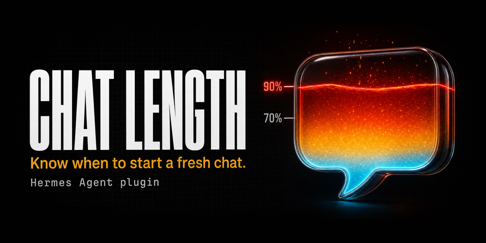

# chat-length



A Duckwork Agent plugin that tells you when a chat is getting too long, and hands you a short opener for a fresh chat. In the new chat, Duckwork pulls the earlier context itself with its built-in `session_search` tool.

No handover protocol, no auto-opening of chats, no changes to the system prompt.

## What the notice looks like

> **Heads-up: this chat is getting long** (about 72 % of the way to automatic compaction). Replies get slower and less precise from here on. Best to open a new chat and paste this opener:
>
> ```text
> Continue our chat "Summer party in Cologne" (session 20261015_141559_2a617f). First retrieve the history yourself with session_search (session_id 20261015_141559_2a617f).
> Status:
> * Beach theme chosen
> * Decoration, tech and catering budget roughly planned
> Open: venue, bad-weather plan.
> ```

At the second threshold (default 90 %) an urgent version appears. Each level shows up exactly once per chat. When Duckwork compacts the chat and the fill level drops clearly, both levels re-arm.

## Why

Long chats get slow, expensive and fuzzy, and automatic compaction throws details away. Handover documents are a weak fix: they are long, they go stale, and nobody reads them. Duckwork already keeps every session searchable, so all a new chat needs is a pointer. This plugin produces exactly that pointer, at the right moment.

## How it works

| When | Hook | What happens |
|---|---|---|
| After every model call | `post_api_request` | Stores the real provider numbers (prompt tokens including cache, output tokens) and the active model's context length. |
| Before the next turn | `pre_llm_call` | Fill level = last measurement + last reply + new message. When a threshold is crossed for the first time, the model is told, for this one turn only, to append the notice below its normal answer. |

**Provider numbers, not guesses.** The plugin uses what the provider actually billed. Without a measurement (the first turn of a chat, or the first turn after a restart) it simply waits one turn; the measurement from that turn is used from the next turn on.

**Prompt caching stays intact.** The instruction travels through the regular hook channel into the current turn's user message, never into the system prompt. Duckwork stores exactly the bytes it sent and replays them unchanged in later turns. Verified with request dumps: in the following turn every earlier message, including the one that carried the instruction, was byte-identical, and the system prompt never changed.

**Runs server-side**, so it works wherever Duckwork answers: CLI, WebUI, Duckwork Desktop, Telegram and the other gateways. Background jobs (cron, subagents, Kanban, batch, webhooks) never get a notice.

## Measured against compaction, not the full window

Duckwork compacts long chats automatically (`compression.threshold`, default 50 % of the context window, at least 75 % for windows below 512K). With the default setting, a notice at 70 % of the *full* window would never fire, because Duckwork compacts first. So by default the plugin measures against the compaction point: 70 % means "70 % of the way to compaction". Set `basis: window` to measure against the full context window instead. If compaction is disabled, the full window is used automatically.

## Installation

```bash
duckwork plugins install MadeByBrain/duckwork-chat-length --enable
duckwork gateway restart        # or restart your WebUI / Desktop backend
```

Pin an exact version (`--ref` only accepts the full 40-character commit SHA, not a tag; the SHA for each release is listed under Releases):

```bash
duckwork plugins install MadeByBrain/duckwork-chat-length --ref <commit-sha> --enable
```

Check:

```bash
duckwork plugins list | grep chat-length
```

## Settings

In `config.yaml`, or in Duckwork Desktop under Settings, Plugins, chat-length:

```yaml
plugins:
  entries:
    chat-length:
      settings:
        threshold_1: 0.70        # first notice
        threshold_2: 0.90        # urgent notice
        basis: compaction        # or: window
        language: auto           # auto, en or de
        disabled_platforms: [cron, subagent, kanban, batch, webhook]
```

| Setting | Default | Meaning |
|---|---|---|
| `threshold_1` | `0.70` | Fill level (0 to 1) for the first notice. |
| `threshold_2` | `0.90` | Fill level for the urgent notice. |
| `basis` | `compaction` | `compaction` = relative to the point where Duckwork compacts; `window` = relative to the full context window. |
| `language` | `auto` | `auto` = the model writes the notice in the language of the conversation (English template, translated). `en` / `de` = fixed, hand-written wording. |
| `disabled_platforms` | background jobs | Platforms that never get a notice. |

Tip for very large windows (1M tokens): compaction at 50 % sits at 500K tokens, so a first notice at 70 % comes only after roughly 350K tokens. Lower thresholds such as `0.50` and `0.80` give earlier nudges.

## Recommended addition to SOUL.md

So that a new chat also works without the opener, when someone simply writes "as we discussed":

```text
Earlier conversations: when the user refers to an earlier conversation with you ("as discussed", "in our last chat", "where did we leave off") or names a session id, search for it with session_search first (by session_id if one is given, otherwise by keywords with sort newest). Only then fall back to other sources. If you find nothing, say so openly and ask.
```

## Tests

```bash
cd /path/to/duckwork-agent
DUCKWORK_HOME=$(mktemp -d) venv/bin/python /path/to/duckwork-chat-length/tests/test_chat_length.py
duckwork plugins validate /path/to/duckwork-chat-length
```

22 offline checks without any model call (levels, one-time firing, re-arming after compaction, background jobs, long pastes, languages, error cases). Run with the Duckwork interpreter so the real Duckwork compaction helpers are exercised too.

## Data and disclosure

Network: none. Duckwork core: public hooks plus read-only config access, no private imports, no core patches.

One small entry per chat in `<DUCKWORK_HOME>/plugin-data/chat-length/sessions.json` (token counts, model, which level has fired). No message content. Entries older than 30 days are removed on the next write. The chat title is read read-only from `state.db`.

## Requirements

Duckwork Agent v0.21.5 or newer (tested on v0.21.6 and v0.22.2). Python standard library only.

## About

Built by [MadeByBrain](https://madebybrain.com) for production Duckwork deployments in the German-speaking market. Issues and pull requests welcome.

## License

MIT, see `LICENSE`.
