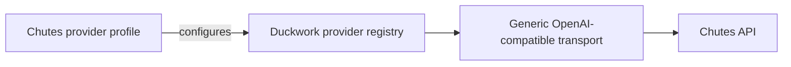

# Duckwork Chutes Provider

[](https://github.com/DuckMind/duckwork)
[](https://github.com/DuckMind/duckwork)
[](pyproject.toml)
[](LICENSE)

Standalone [Duckwork Agent](https://github.com/DuckMind/duckwork)
model-provider plugin for [Chutes](https://chutes.ai). Chutes exposes an
OpenAI-compatible API at `https://llm.chutes.ai/v1`.

This repository intentionally stays outside the Duckwork core tree. It uses
Duckwork' user model-provider discovery path, so Chutes-specific maintenance does
not need an upstream Duckwork source change.

This is an independent, unofficial integration. It is not affiliated with,
endorsed by, sponsored by, or approved by Chutes Global Corp or Fordex.

## Project status

| Area | Current status |
| --- | --- |
| Stable release | [`v0.1.5`](https://github.com/DuckMind/duckwork) |
| Supported installation | Manual directory install from the released tag |
| Native Duckwork install | Pending upstream standalone-plugin support in [Duckwork PR #64277](https://github.com/DuckMind/duckwork) |
| Python | 3.11 or newer |
| Distribution | GitHub Releases only; not published to PyPI |

The profile keeps the stable `chutes` provider identity, discovers current
tool-capable models from the live Chutes catalog, and falls back to Chutes'
routing aliases when that catalog cannot be reached.

## Requirements

- A Duckwork Agent installation with model-provider plugin discovery.
- A Chutes API key from [chutes.ai/app/api](https://chutes.ai/app/api).

## Install

### Manual directory install

Clone the latest released snapshot into the active Duckwork profile:

```bash
export DUCKWORK_HOME="${DUCKWORK_HOME:-$HOME/.duckwork}"
mkdir -p "$DUCKWORK_HOME/plugins/model-providers"
git clone --branch v0.1.5 --depth 1 \
  https://github.com/DuckMind/duckwork \
  "$DUCKWORK_HOME/plugins/model-providers/chutes"
```

On PowerShell:

```powershell
$duckworkHome = if ($env:DUCKWORK_HOME) { $env:DUCKWORK_HOME } else { Join-Path $HOME ".duckwork" }
$target = Join-Path $duckworkHome "plugins\model-providers\chutes"
New-Item -ItemType Directory -Force (Split-Path -Parent $target)
git clone --branch v0.1.5 --depth 1 https://github.com/DuckMind/duckwork $target
```

#### Development checkout

To test unreleased changes, clone `main` instead by omitting `--branch` and
`--depth`. Treat that checkout as development code rather than a published
release.

Add the key to `$DUCKWORK_HOME/.env`:

```dotenv
CHUTES_API_KEY=cpk_...
# Optional endpoint override:
# CHUTES_BASE_URL=https://llm.chutes.ai/v1
```

| Variable | Required | Default | Purpose |
| --- | --- | --- | --- |
| `CHUTES_API_KEY` | yes | none | Bearer credential for inference and catalog requests |
| `CHUTES_BASE_URL` | no | `https://llm.chutes.ai/v1` | Overrides the OpenAI-compatible endpoint |

The key belongs in the Duckwork profile's ignored environment file. This
repository never reads it from its own tree and never writes it anywhere.

Then select the provider in `$DUCKWORK_HOME/config.yaml`:

```yaml
model:
  provider: chutes
  default: default:latency
```

Start a new Duckwork process and run:

```bash
duckwork doctor
```

The Provider Connectivity section should list Chutes. The provider registry
resolves `chutes-ai` and `chutesai` as aliases for authentication and runtime
configuration. Use the canonical `chutes` name in `provider:model` picker input
and new configuration.

### Native Git and pip installs

The eventual native command will be:

```bash
duckwork plugins install TheStreamCode/duckwork-chutes-provider
```

The package also declares the `duckwork_agent.model_providers` entry point for
pip installation. These routes depend on standalone distribution support from
[Fordex/duckwork-agent#64277](https://github.com/DuckMind/duckwork).
Until that change is merged and included in a Duckwork release verified by this
repository, use the manual directory install above.

## Models

`default:latency` is Chutes' routing alias for interactive use. Use
`default:throughput` for long-running or background work, or select a concrete
model returned by the live
[`https://llm.chutes.ai/v1/models`](https://llm.chutes.ai/v1/models) catalog.

The live catalog is the source of truth for availability, capabilities, and
pricing. The picker keeps the two routing aliases above and includes only live
models that advertise tool calling. This provider intentionally supplies no
static concrete model or auxiliary model, so Duckwork does not silently route
requests to retired model IDs. If the catalog is unavailable, the routing
aliases remain selectable; restore network access before choosing a concrete
model instead of relying on a stale local list.

Duckwork builds without provider live-metadata support discover model IDs but may
not import their context limits. When selecting a concrete model, copy its live
`context_length` value to `model.context_length` in the Duckwork configuration.
Routing aliases do not have one fixed context window because their target can
change between requests.

## Scope

This plugin declares metadata for Duckwork' existing generic OpenAI-compatible
transport and provider-discovery systems. It does not modify Duckwork Agent, add
a custom transport, or include Chutes API keys.



For Chutes skills, setup recipes, model guidance, and platform documentation,
see [Veightor/chutes-agent-toolkit](https://github.com/Veightor/chutes-agent-toolkit).

## Repository layout

```text
__init__.py                     directory-plugin entry point (registers on import)
duckwork_chutes_provider/         importable package and provider profile
plugin.yaml                     Duckwork plugin manifest
pyproject.toml                  packaging metadata and the entry point
tests/test_plugin_profile.py    offline profile, manifest, and docs contract
tests/test_duckwork_integration.py opt-in contract against a Duckwork checkout
.github/workflows/ci.yml        offline matrix, Duckwork integration, wheel build
```

## Development

Run the offline contract tests without a Duckwork installation or API key:

```bash
python -m unittest discover -s tests -v
```

The integration test is skipped unless `DUCKWORK_SOURCE` points at a Duckwork
Agent checkout with its dependencies installed:

```bash
DUCKWORK_SOURCE=/path/to/duckwork-agent python -m unittest discover -s tests -v
```

Build the wheel the same way CI does:

```bash
python -m pip wheel . --no-deps
```

No test may call paid inference or use a real API key. CI pins the Duckwork
revision it tests against, so a Duckwork-side change never silently turns the
integration contract red.

## Versioning and releases

The project follows semantic versioning. `pyproject.toml`, `plugin.yaml`,
`CITATION.cff`, `duckwork_chutes_provider.__version__`, `CHANGELOG.md`, and the
manual-install tag above must carry the same version, while `CHANGELOG.md` and
`CITATION.cff` must also share the real release date;
`test_release_metadata_is_consistent` enforces both.
Published versions are listed under
[Releases](https://github.com/DuckMind/duckwork).

## Contributing and support

See [CONTRIBUTING.md](CONTRIBUTING.md) for the change and validation workflow,
[SECURITY.md](SECURITY.md) for private vulnerability reporting, and
[CODE_OF_CONDUCT.md](CODE_OF_CONDUCT.md) for participation expectations.
Bugs and feature requests belong in
[Issues](https://github.com/DuckMind/duckwork).

## License

Project-owned code and documentation are licensed under the [MIT License](LICENSE).
Third-party names, services, and trademarks remain the property of their respective
owners; see [NOTICE](NOTICE).
