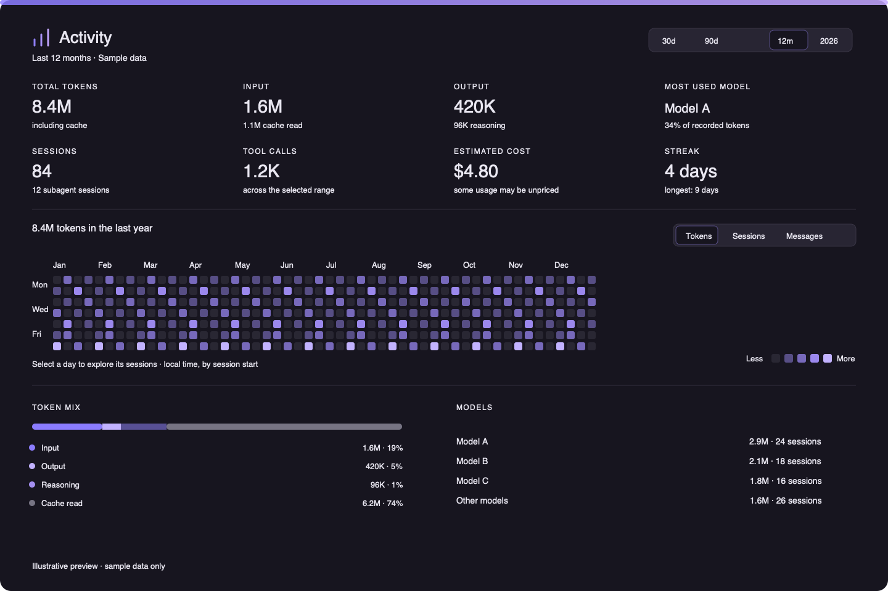

# duckwork-activity

A read-only activity dashboard for Duckwork Desktop. It adds a GitHub-style daily contribution grid, token totals and breakdowns, model and platform usage, tools, skills, activity hours, and notable sessions.



## Requirements

- Duckwork Agent `>=0.21.7` for the public signed-in provider request API
- Node.js `>=22.18` for native TypeScript provider collection, and npm to build the desktop UI
- Python is provided by Duckwork for the native plugin backend; no additional Python dependencies are installed

## Install from Git

```sh
duckwork plugins install https://github.com/DuckMind/duckwork
duckwork plugins enable duckwork-activity
```

Enable the Activity desktop surface in **Capabilities → Plugins**. On a local Duckwork Desktop install, the page appears in the sidebar and in the `⌘K` palette as **Open Activity**. The desktop surface is opt-in when installed as part of a plugin package.

## Development

See [CONTRIBUTING.md](CONTRIBUTING.md) for setup, tests, privacy requirements and pull request guidelines.

```sh
npm install
npm run build
npm run install:local
```

`install:local` copies the compiled `desktop/plugin.js` into `$DUCKWORK_HOME/desktop-plugins/duckwork-activity/`. Duckwork Desktop watches this folder and hot-reloads the entry. Set `DUCKWORK_HOME` when testing a non-default profile/home.

The UI source is `src/plugin.tsx`; TypeScript compilation and the local bundling script produce one self-contained ESM entry, with runtime imports limited to the Duckwork Desktop SDK and React. Styling uses Duckwork theme tokens and components so the page follows the active theme.

## Data and privacy

The Duckwork tab reads the selected profile's `state.db` in SQLite read-only mode. Aggregates are computed locally on that profile. The desktop page uses Duckwork' profile-routed `cli.exec` RPC; remote profiles run collection on their configured gateway.

The Providers tab is independent of the Quota plugin. Passive reads are cache-only, using `$DUCKWORK_HOME/plugin-data/duckwork-activity/activity_provider_history.json` in the selected profile. Activity also optionally reads `$DUCKWORK_HOME/quota_cache.json` for display-only plan labels and quota windows. It never uses quota windows as dated usage history.

**Fetch provider data** uses only Duckwork's public credential routes:

| Provider | Credential route | HTTPS hosts and endpoints |
| --- | --- | --- |
| Codex | Declared `requires_auth: [openai-codex]`; Duckwork's `credentialed_provider_request` attaches the signed-in account credentials. Activity never receives the token. | `chatgpt.com/backend-api/wham/profiles/me` |
| CommandCode | Optional `COMMAND_CODE_API_KEY` through `agent.secret_scope.get_secret` | `api.commandcode.ai/alpha/whoami`, `/alpha/billing/subscriptions`, `/alpha/usage/summary` |
| OpenCode | Optional `OPENCODE_CONSOLE_API_KEY`, then `OPENCODE_API_KEY`, then `OPENCODE_GO_API_KEY`, through `agent.secret_scope.get_secret` | `opencode.ai/console/api/v2/usage/export` |
| Ollama | Optional `OLLAMA_API_KEY` through `agent.secret_scope.get_secret` | `ollama.com/api/usage?range=30d` |

Configure optional keys through Duckwork's plugin secret configuration. OpenCode exports require a Console key with usage-read access; an inference-only key may not work. Activity does not directly read Duckwork's `auth.json`, profile `.env`, credential pools, or other CLIs' token files. The Node child receives only the resolved optional API keys and an explicit `PATH`, `HOME`, and `DUCKWORK_HOME` environment, with only Windows runtime essentials (`SYSTEMROOT`, `WINDIR`, `COMSPEC`, `TEMP`, `TMP`, `PATHEXT`, `SYSTEMDRIVE`) retained case-insensitively from the parent, plus the credentialless Codex response over stdin. Passive reads do not resolve secrets or make provider requests. Missing credentials or an unavailable public API are reported, never replaced with a private-file fallback.

CommandCode reports period totals only; Codex reports dated token buckets; OpenCode reports daily export totals; Ollama reports dated daily buckets and period totals from its rolling usage API (maximum requested range: 30 days), with legacy activity-period summaries still supported. Previously collected daily buckets remain in the local cache; a first refresh cannot reconstruct a full year. Ollama's range response does not report model breakdowns or quota counters. Missing metrics stay unknown, not zero. Summary-only totals never enter the annual heatmap. Combined figures represent reported account/workspace activity, not exclusively Duckwork sessions, and can have partial source coverage.

No telemetry or credential values are stored in the usage cache or returned to the desktop. Refresh does not implement sign-in or credential changes; Duckwork manages authentication through its public routes. Provider caches store normalized usage aggregates and hashed scope identifiers where available. See [THIRD_PARTY_NOTICES.md](THIRD_PARTY_NOTICES.md) for source-adapter attribution.

- `duckwork activity provider-history --days 365 --desktop --json`
- `duckwork activity provider-history --days 365 --desktop --json --refresh`

- `duckwork activity summary --days 30 --json`
- `duckwork activity summary --year 2026 --json`
- `duckwork activity summary --days 365 --desktop --json` for the desktop page's compact breakdown payload
- `duckwork activity day 2026-01-15 --json`
- `/activity 30` in a Duckwork session

Daily buckets use the machine’s local time and assign a session to the date it started. Counts include subagent tokens; top-level and subagent session counts are shown separately. Cost is based on stored Duckwork billing estimates/actuals and is not a provider-wide billing statement.

## Validation

```sh
npm run typecheck
npm run build
duckwork plugins validate .
```

## License

MIT. See [LICENSE](LICENSE).
