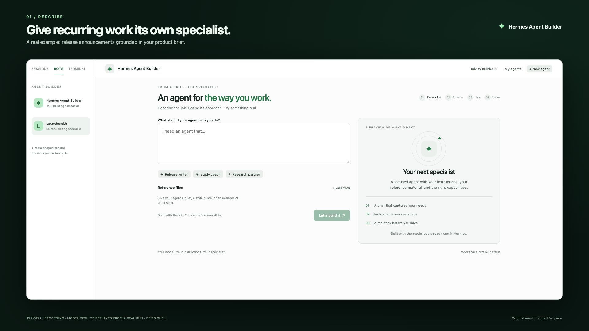

# Duckwork Agent Builder


Maintained by [itsflownium](https://github.com/itsflownium). A community plugin for Duckwork Desktop.

A dedicated Duckwork Desktop section that turns a conversation about your needs into a reusable specialist agent.

Describe the job → answer Duckwork's questions → refine the blueprint → try real work → save the agent.

The entry appears only while **BOTS** is selected. Saved specialists live in the native bot roster. The package uses Duckwork's native Desktop Plugin SDK, plugin API namespace, model facade, and profile creation/configuration APIs. It does not patch Duckwork core.

## Demo

[Watch the 69-second Launchsmith demo](docs/demo.mp4) — a release-writing specialist built from a real brief, from interview through native Bot Mode handoff.



The recording uses the actual plugin UI in an isolated demo shell, with model responses replayed from a real run to shorten waiting. Native profile saving and its canonical Bot Chat were verified separately. The film labels those boundaries. The logo and music are original.

## Install

Install directly from this repository:

```sh
duckwork plugins install https://github.com/DuckMind/duckwork
duckwork plugins enable duckwork-agent-builder
```

Catalog inclusion is pending maintainer review. After admission, the install identifier will be `duckwork-agent-builder`.

Requires a recent Duckwork Desktop with the Desktop Plugin SDK and Plugin LLM Access (validated against Duckwork source `449fae030a`, September 2026), and Python 3.11 or newer.

Extract the package, then run from this folder:

macOS:

```sh
python3 install.py --enable
```

Windows PowerShell:

```powershell
py -3 install.py --enable
```

If Python cannot find Duckwork, use its Python interpreter or run the native enable command separately:

```sh
duckwork plugins enable duckwork-agent-builder
```

In Duckwork Desktop, open **Capabilities → Plugins**, rescan if needed, then enable **Duckwork Agent Builder's Desktop component**. The agent and Desktop components have separate native enable switches. Reconnect an already-running backend once to mount the API routes. Your model must be signed in/configured in Duckwork.

Use `--home <path>` for an explicit profile home; use `--update` for a code update. Runtime data remains in Duckwork's profile-scoped `plugin-data/duckwork-agent-builder/` and survives code updates.

## Use

1. Select **BOTS**, then choose **Agent Builder** in the top bar. **Talk to Builder** opens the conversational companion in the native bot roster.
2. Describe a recurring task. Add a short text reference file if useful.
3. Answer Duckwork's tailored questions in your own words or choose a suggestion.
4. Review the agent's name, instructions, capabilities, and examples. Refine it conversationally or edit its instructions directly.
5. Choose **Try it** and provide a real task. After a refinement, compare the two versions on the same prompt.
6. Choose **Save agent**, then **Open in Bot Mode** to start its canonical native Bot Chat.

The saved agent gets a separate profile. It clones the source profile's configuration and installed skills, with fresh memory and chat history. Duckwork handles credential inheritance; messaging channels are not cloned. The builder selects the requested skills/toolsets and leaves MCP servers disabled until configured in Duckwork. Review access in the native profile editor if your specialist needs connected services.

The exact tool list is pinned, including an empty selection for a conversation-only bot. Duckwork's essential `duckwork-agent` skill always remains enabled; other skills follow your selection.

The trial uses instructions and supplied reference material with the host's model. It does not execute connected tools or simulate their results. Use the saved agent's native chat to exercise tools. Each blueprint change starts a new trial context; old trial results do not validate new instructions.

Reference files: UTF-8 `.txt`, `.md`, `.csv`, `.json`, `.yaml`, `.yml`; up to six files and 60,000 characters combined. Reference contents are source data, not standing instructions.

**Copy blueprint** copies portable instructions and references, without credentials, chat history, or memory. Drafts are persisted on the backend. Saved profiles are managed through Duckwork's profile editor.

Briefs and answers also survive frontend reloads. Model requests have bounded timeouts, elapsed-time feedback, and a **Stop waiting** control. Stopping the wait does not cancel a server request already running; check **My agents** before retrying. Optional malformed model suggestions are ignored so the actual question and free-text answer remain usable.

## CLI and agent use

```text
/build-agent Make a study coach that explains one concept at a time and asks me a practice question.
```

The `agent_builder` tool creates or refines a draft in a normal conversation. The desktop section provides the full guided interview and save flow.

## Platform support and validation

One package runs on macOS and Windows: no shell-dependent runtime, hardcoded Unix paths, Node APIs in the renderer, or external JavaScript imports. The installer resolves native Duckwork homes (including Windows LocalAppData) and preserves profile data. The UI adapts to narrow windows, native themes, keyboard control, and reduced-motion preferences.

The code avoids platform-specific runtime dependencies, and installer paths containing spaces are tested. A native Windows/Electron run still needs validation on Windows; this package does not claim it was performed.

See `VALIDATION.md` for the completed checks and demo evidence.

## Development

The Python backend registers commands/tools through `register(ctx)` and calls `ctx.llm`. REST requests invoke the same registered command. Storage resolves the active profile on every operation; SQLite transactions prevent stale in-flight responses from overwriting newer drafts.

The desktop half is plain ESM using only `@duckwork/plugin-sdk` and React. No frontend build step is required.

Files:

```text
plugin.yaml                  native plugin manifest
__init__.py                  registrations
builder.py                   interviews, blueprints, trials, storage
desktop/plugin.js            BOTS-only entry and guided builder UI
dashboard/plugin_api.py      profile-aware REST endpoints
install.py                   portable installer
examples/launch-brief.md     real demo source material
```
