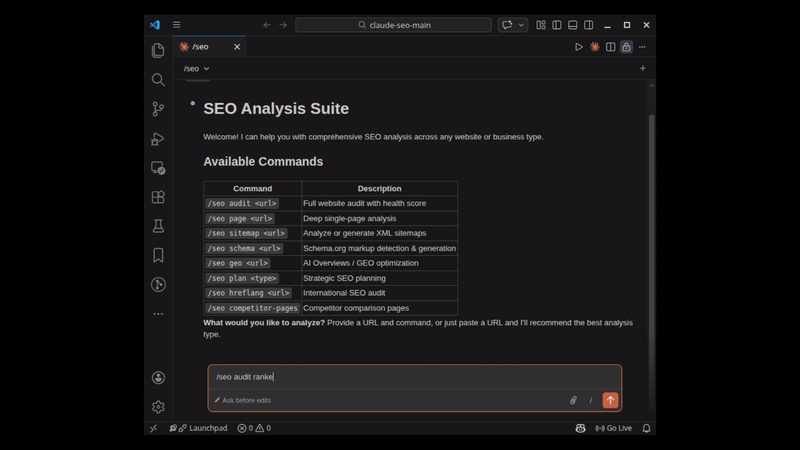
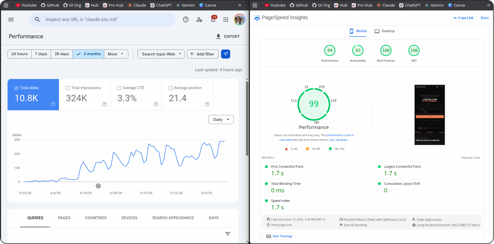

# Duckwork SEO

<p align="center">
  <a href="assets/duckwork-seo-promo.mp4">
    
  </a>
</p>

Duckwork SEO is a native Duckwork plugin port of SEO workflows from [Claude SEO v2.4.2](https://github.com/AgriciDaniel/claude-seo). It includes 25 workflow skills plus the `seo` router, 19 specialist role skills, 56 utility scripts, Schema.org templates, and optional integrations. Claude SEO was created by Daniel Agrici. See [credits](assets/media-credits.md) for upstream attribution and media notes.

This independent community plugin is maintained at [yuzushi-dev/duckwork-seo](https://github.com/DuckMind/duckwork). It is listed in the [Duckwork plugin catalog](https://duckwork-agent.fordex.com/docs/plugins/duckwork-seo). Release [v0.1.0](https://github.com/DuckMind/duckwork) remains available.

## What it does

The plugin helps Duckwork inspect websites, prepare SEO recommendations, validate or draft structured data, and run focused workflows for content, local search, international SEO, and AI search visibility. Its skills guide the analysis; bundled utilities handle specific checks and transformations.

The map below groups the 25 workflow skills. Provider integrations are optional, and Google OAuth workflows remain disabled because Duckwork does not yet provide a profile-scoped authorization route.

<p align="center">
  
</p>

## Install

Install the released commit from GitHub with Duckwork' Git installer:

```bash
duckwork plugins install https://github.com/DuckMind/duckwork --ref 5f04951e8fddc8b869378236a7ff5b584a0d023d --yes-deps --enable
duckwork plugins doctor duckwork-seo --ci
```

The `--ref` value pins the install to the v0.1.0 commit. `--yes-deps` consents to installing the plugin's declared Python dependencies, including in non-interactive shells. The plugin registers namespaced skills such as `duckwork-seo:seo-audit` and `duckwork-seo:role-seo-technical`; use `skills_list` and `skill_view` to discover or load them. The `duckwork-seo:seo` skill routes general SEO requests. The runtime commands are `duckwork seo setup`, `duckwork seo doctor`, and `duckwork seo run`.

`duckwork seo setup` creates a private virtual environment and downloads pinned Python packages. Browser setup also downloads Chromium and may use substantial disk space. Setup is user initiated. `duckwork seo doctor --json` checks readiness without changing the system. Use `duckwork_seo_run` for credentialed utilities and `duckwork seo run <script.py>` for noncredentialed utilities. Both run through the isolated environment and script allowlist.

## Main workflows

| Workflow | Skill | Use it for |
| --- | --- | --- |
| Site audit | `duckwork-seo:seo-audit` | Site-wide findings and priorities |
| Technical SEO | `duckwork-seo:seo-technical` | Crawlability, indexing, and technical checks |
| Page review | `duckwork-seo:seo-page` | On-page analysis of one URL |
| Content brief | `duckwork-seo:seo-content-brief` | Planning a page around a topic |
| Structured data | `duckwork-seo:seo-schema` | Inspecting, validating, or drafting Schema.org JSON-LD |
| AI search | `duckwork-seo:seo-geo` | Generative Engine Optimization analysis |
| Local SEO | `duckwork-seo:seo-local` | Local visibility and business profile checks |
| Strategy | `duckwork-seo:seo-plan` | SEO planning for a site or business type |

## Example requests

Ask Duckwork in natural language, for example:

- “Run `duckwork-seo:seo-audit` on `https://example.com` and give me the highest-priority findings with evidence.”
- “Use `duckwork-seo:seo-schema` to inspect the JSON-LD on `https://example.com/about` and suggest a corrected block.”
- “Load `duckwork-seo:seo-content-brief` and create a brief for a guide to accessible home renovation.”
- “Use `duckwork-seo:seo-technical` to check the sitemap, robots.txt, canonical tags, and page status codes for `https://example.com`.”

The agent can also load the router with “Use `duckwork-seo:seo` to help me investigate this site's search visibility.”

## Example report

The original Claude SEO README includes this excerpt from a Schema.org audit dated 2026-02-09:

> Schema types: Organization, WebSite, SoftwareApplication. Critical issues: 2; warnings: 5; passed checks: 18; overall grade: B+.

Source: [upstream sample report](https://github.com/AgriciDaniel/claude-seo). The excerpt is reproduced from the original Claude SEO README.

## Method framework

Claude SEO's ten-principle method groups its principles into four phases: perceive, analyze, validate, and act. The diagram is adapted from the upstream graphic with Duckwork SEO branding.

<p align="center">
  
</p>

The separate FLOW skill and its prompt materials remain attributed under CC BY 4.0. See [the FLOW skill](skills/seo-flow/SKILL.md).

## Upstream demo and project data

This upstream recording shows the Claude SEO audit workflow in the Claude Code interface.

<p align="center">
  
</p>

Google Search Console growth and PageSpeed results for `claude-seo.md`, published by Daniel Agrici in the [upstream project](https://github.com/AgriciDaniel/claude-seo) for March to June 2026.

<p align="center">
  
</p>

## Compatibility and limits

The native plugin requires Duckwork Agent 0.22.2 or newer and supports Linux and macOS. Windows is not declared because the registered runtime launches through Bash. Python 3.10 or newer with `venv` support is required for the managed SEO runtime.

The package preserves optional integrations for DataForSEO, Banana image generation, Firecrawl, Ahrefs, SE Ranking, Profound, Bing Webmaster, Matomo, and Unlighthouse. They require compatible MCP servers or individual service credentials and stay inactive unless configured in Duckwork. Setup scripts that wrote Claude Code configuration were removed. See [extension notes](docs/EXTENSIONS.md) for what is retained and what remains unverified.

Do not call paid endpoints, spend API credits, or submit data to external services without the user's explicit approval for that operation. Skills request approval before external or paid operations; `duckwork_seo_run` does not enforce an approval policy. Skills must report when a provider or credential is unavailable. CI skips the suite's explicit live-network render check and does not call provider APIs.

Google Search Console, GA4, Google Ads, and Indexing API OAuth flows remain disabled until Duckwork provides a profile-scoped Google authorization route. Supported profile-vault names are `GOOGLE_API_KEY`, `MOZ_API_KEY`, `BING_WEBMASTER_API_KEY`, `KEYWORDSEVERYWHERE_API_KEY`, `MATOMO_API_TOKEN` or `MATOMO_TOKEN`, `MATOMO_URL`, `MATOMO_SITE_ID` or `MATOMO_IDSITE`, `DUCKWORK_SEO_LOCAL_TARGETS`, `DATAFORSEO_USERNAME`, `DATAFORSEO_PASSWORD`, `INDEXNOW_KEY`, and Banana's `GOOGLE_AI_API_KEY`. IndexNow's nonsecret key-location URL stays a normal script argument. Secrets are never catalog metadata or repository files.

The runtime allowlists bundled scripts, rejects path traversal, and uses the source project's SSRF and DNS-rebinding protections. Runtime files and browser binaries use the active Duckwork plugin data directory; credentials remain in the active Duckwork profile vault and are injected only for an allowlisted script. No credential files belong in this repository. Schema feedback runs after Duckwork file-write tools and returns findings to the model; it does not block or roll back a write.

The plugin can start local subprocesses for its managed Python runtime through `duckwork_seo_run`. This native tool runs in the Duckwork host plugin process; a Docker terminal sandbox does not contain it. Script arguments may therefore name host paths accessible to that process. `duckwork seo setup` downloads Python packages and, unless skipped, Chromium. Audit workflows fetch user-selected websites. Optional integrations send data to their named third-party providers and may incur charges; they remain inactive until separately configured. The plugin stores its managed environment, cache, and runtime configuration in Duckwork plugin data storage. It does not include telemetry or a self-updater.

The core project is MIT licensed. The FLOW framework and its prompt materials remain CC BY 4.0 with source attribution. See [LICENSE](LICENSE), [the FLOW skill](skills/seo-flow/SKILL.md), and [media credits](assets/media-credits.md).

## Validation

```bash
duckwork plugins validate /path/to/duckwork-seo
duckwork plugins doctor /path/to/duckwork-seo --ci
rtk pytest -q
```

The source suite covers local script behavior and security boundaries. API-backed behavior needs the corresponding service account and was not validated as part of the local port.

Catalog preparation metadata is available in [docs/catalog-submission-template.yaml](docs/catalog-submission-template.yaml), the catalog entry template.
