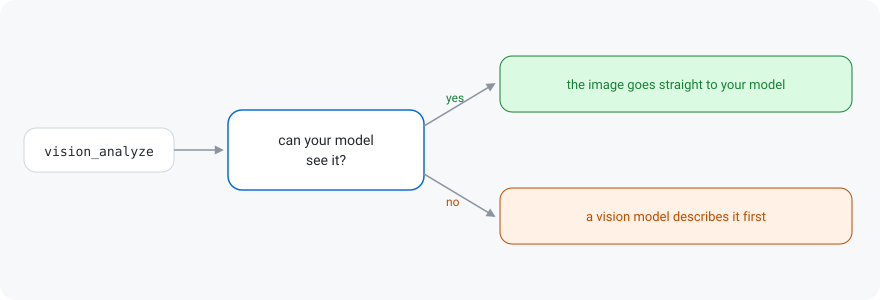

# duckwork-vision-inline

A Duckwork plugin that attaches an image to your session model inline when the model can see it, instead of letting the auxiliary vision model write a description.

Core already attaches images natively by default. What this plugin changes is an explicit `auxiliary.vision` backend: with a captioning model configured, core sends every `vision_analyze` call there, and this plugin keeps the image in the conversation instead when the main model accepts it. The plugin still respects `agent.image_input_mode: text`, which turns image attachment off.

Keeping the image inline preserves the full context, supports follow-up questions without reprocessing, and lets the model inspect details directly.



## Install

Linux and macOS:

```bash
git clone https://github.com/DuckMind/duckwork
cd duckwork-vision-inline
./install.sh
```

Windows, from PowerShell in a clone:

```powershell
git clone https://github.com/DuckMind/duckwork
cd duckwork-vision-inline
.\install.ps1
```

The script copies the plugin to `~/.duckwork/plugins/duckwork-vision-inline` and
enables it. By hand, the same two steps:

```bash
duckwork plugins enable duckwork-vision-inline
systemctl --user restart duckwork-dashboard.service
```

The desktop backend caches its plugin list per process, so a restart is *needed*.

## Usage

When the model calls _vision_analyze_, the plugin looks up the session model and
picks a path:

| condition | path taken |
| --- | --- |
| `agent.image_input_mode` is `text`, the provider drops images inside tool results, or the model is not listed as vision-capable | `vision_analyze_tool` runs; the auxiliary vision model returns `{"success": true, "analysis": "..."}` |
| the model accepts images | `_vision_analyze_native` runs; the image is encoded into the tool result as an `image_url` part |

## How the model is identified

The decision of whether a model is vision-capable comes from the models.dev catalog Duckwork keeps on disk
(`~/.duckwork/models_dev_cache.json`, 8000+ models, refreshed by Duckwork).

## Install without a plugin loader

The plugin is two files. Copy `__init__.py` and `plugin.yaml` into
`~/.duckwork/plugins/duckwork-vision-inline/` and the loader picks them up; there
are no dependencies to resolve and nothing to configure.

## Uninstall

```bash
duckwork plugins disable duckwork-vision-inline
```

## License

MIT. See [LICENSE](LICENSE).
