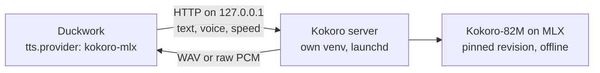

# duckwork-kokoro-tts

Local [Kokoro](https://huggingface.co/hexgrad/Kokoro-82M) text-to-speech for [Duckwork Agent](https://duckwork-agent.fordex.com/docs/) on Apple Silicon. Duckwork speaks with a natural voice in nine languages, sentence by sentence as the reply streams, and the text never leaves your Mac.

- **Native Duckwork TTS provider**: set `tts.provider: kokoro-mlx` and every surface that speaks (Desktop read-aloud, voice mode, wake word, `text_to_speech`) uses it.
- **Streaming**: raw PCM per sentence, so the first words play while the rest of the reply is still being written.
- **Any Kokoro voice**: 54 voices in American and British English, Spanish, French, Hindi, Italian, Japanese, Brazilian Portuguese and Mandarin.
- **Isolated and offline**: the model runs in its own Python environment behind a loopback-only server. Duckwork' own environment gets nothing new, and after installation nothing touches the network.
- **Pinned**: one reviewed model revision. Updating it is a code change you can see.

## Requirements

- macOS on Apple Silicon (MLX runs only there).
- Duckwork Agent 0.22.2 or later (the version it is tested on).
- [`uv`](https://docs.astral.sh/uv/) (`brew install uv`). It also fetches Python 3.11 if you don't have it.
- About 1.5 GB of disk: ~1.1 GB of Python packages and ~340 MB of model.

## Install

```sh
duckwork plugins install brunosouzas/duckwork-kokoro-tts
duckwork kokoro install                 # builds the server environment, downloads the model, starts it
duckwork config set tts.provider kokoro-mlx
duckwork kokoro say "Hello from Duckwork"  # writes a test WAV and prints its path
```

`duckwork kokoro install` is idempotent: run it again after an update or after changing the port.

**Upgrading from 0.1.0:** the provider is now called `kokoro-mlx` (it was `kokoro`). Duckwork reserves the names of its built-in providers, and a built-in `kokoro` has been proposed upstream, so the plugin uses a name that cannot collide. Run `duckwork config set tts.provider kokoro-mlx` once.

## Choose a voice

```sh
duckwork kokoro voices                                            # what the installed model offers
duckwork config set plugins.entries.kokoro-tts.settings.voice bf_emma
```

The first letter of a voice id is its language (`a` US English, `b` UK English, `e` Spanish, `f` French, `h` Hindi, `i` Italian, `j` Japanese, `p` Brazilian Portuguese, `z` Mandarin) and the second its gender. Some starting points: `af_heart`, `am_michael`, `bf_emma`, `bm_george`, `ef_dora`, `ff_siwis`, `if_sara`, `pf_dora`, `pm_alex`.

If `tts.voice` is set in your Duckwork config, it wins over the plugin setting.

### A voice per language

Kokoro reads text with the pronunciation rules of the voice's language, so English read by a Portuguese voice sounds wrong (and the other way round). Give each language its own voice and the plugin picks one per sentence:

```sh
duckwork config set plugins.entries.kokoro-tts.settings.voice pf_dora          # default voice
duckwork config set plugins.entries.kokoro-tts.settings.voices.pt pf_dora
duckwork config set plugins.entries.kokoro-tts.settings.voices.en bf_emma
duckwork kokoro install                                                        # loads both voices at start-up
```

A reply in English is spoken by `bf_emma`, one in Portuguese by `pf_dora`, and a mixed reply switches at sentence boundaries. A sentence with no clear language (a name, a number) keeps the previous voice. Detection counts common function words and accents. It is built into the plugin, needs no extra package, and currently tells Portuguese from English. It works on whole sentences: an English word inside a Portuguese sentence ("o pipeline terminou") still gets the Portuguese pronunciation, because switching voices mid-sentence sounds worse than an accent. Setting `tts.voice` turns switching off.

### English words inside other languages

Switching voices fixes whole sentences, but a Portuguese sentence full of English terms ("o pipeline terminou e o card está no board") still gets those words pronounced as if they were Portuguese. Keep a dictionary of English words and the **same voice** says them in English, with no change of voice mid-sentence:

```sh
duckwork kokoro words add pipeline card deploy merge board "pull request"
duckwork kokoro words                      # list
duckwork kokoro words remove board
duckwork config set plugins.entries.kokoro-tts.settings.english_accent b   # British; default a (American)
```

No list can know in advance which words you use, so it is meant to grow: when you hear a word come out wrong, add it. Changes apply to the next reply without a restart. Matching is case-insensitive, whole-word, and also covers plurals with -s ("cards", "pull requests"). How it works: the sentence is phonemized in the voice's own language, and only the listed words get English phonemes from Kokoro's English pronunciation lexicon. A word the lexicon does not know is pronounced by espeak's English rules instead (still English, though less polished: names like "Kubernetes" usually come out fine, invented words get spelled out). If the phonemes cannot be lined up with the words, the sentence is spoken normally. The dictionary applies to non-English voices; English voices already say these words in English.

Each language loads its pronunciation pipeline the first time it is used after the server starts. The server does that at start-up for `voice` and every voice in `voices`, so run `duckwork kokoro install` again after changing either. Switching to another language later costs a one-off pause: a few seconds for most languages, up to about a minute for English, which loads spaCy and PyTorch.

Languages tested by the author: Brazilian Portuguese and English. The others come from Kokoro and use espeak-ng for pronunciation; Japanese and Mandarin may need extra G2P packages that this release does not install. Reports welcome.

## Settings

All under `plugins.entries.kokoro-tts.settings` (also editable in Duckwork Desktop → Settings → Plugins):

| Key | Default | Meaning |
|---|---|---|
| `voice` | `af_heart` | Kokoro voice id |
| `voices` | empty | Voice per detected language, e.g. `{pt: pf_dora, en: bf_emma}` (see *A voice per language*) |
| `english_words` | empty | Words and short phrases a non-English voice says in English (see *English words inside other languages*) |
| `english_accent` | `a` | Pronunciation of `english_words`: `a` American, `b` British |
| `language` | empty | Single-voice mode: read text in another language with the same voice (`p`, `pt-br`, `e`, …). Empty = the voice's language |
| `speed` | `1.0` | 0.25 to 4.0 |
| `port` | `8770` | Loopback port of the server |
| `service_dir` | `~/Library/Application Support/duckwork-kokoro-tts` | Server environment, model cache and log |

## Commands

| Command | What it does |
|---|---|
| `duckwork kokoro install` | Create or refresh the environment, download the pinned model, install and start the launchd agent `dev.duckwork.kokoro-tts` |
| `duckwork kokoro status` | launchd state, server health, paths |
| `duckwork kokoro restart` | Restart the server |
| `duckwork kokoro voices` | List installed voices |
| `duckwork kokoro say "text" [--voice id]` | Synthesize a test sentence to a WAV file |
| `duckwork kokoro words [list\|add\|remove] [WORD ...]` | Manage the English-words dictionary |
| `duckwork kokoro uninstall [--purge]` | Stop and remove the launchd agent; `--purge` also deletes the environment and the model |

## What it reads, sends and writes

- **Sends** the text Duckwork wants spoken to `http://127.0.0.1:<port>`, on your own machine, bypassing any `http_proxy` setting. Nothing goes to a cloud service. The server does not log the text.
- **Downloads**, during `duckwork kokoro install` only: Python packages through `uv` (PyPI, plus spaCy's `en_core_web_sm` 3.8.0 wheel from its GitHub release, pinned by SHA-256) and the model `mlx-community/Kokoro-82M-bf16` at revision `a71e4d38` from Hugging Face. The server then runs with `HF_HUB_OFFLINE=1`.
- **Writes** your Duckwork `config.yaml` only when you run `duckwork kokoro words add|remove` (the `english_words` setting); the server environment, model cache and log to `service_dir`; a launchd agent to `~/Library/LaunchAgents/dev.duckwork.kokoro-tts.plist`, and the audio files Duckwork asks for (WAV, 24 kHz mono).
- **Listens** only on loopback. The server refuses to bind any other address because it has no authentication.

## How it works



The server is a small standard-library HTTP server (`server/kokoro_server.py`) around `mlx-audio`. It loads the model once at start-up, serializes inference, and resolves each voice from the pinned snapshot on disk, which also sidesteps [mlx-audio#1041](https://github.com/Blaizzy/mlx-audio/issues/1041) (named voices fetched from another repository). It speaks an OpenAI-style `POST /v1/audio/speech` (`response_format` `wav` or `pcm`), so other local tools can use it too.

## Development

```sh
uv venv .venv --python 3.11
uv pip install --python .venv/bin/python "pytest>=8,<10" "numpy>=1.26,<3"
.venv/bin/python -m pytest -q
duckwork plugins validate .
```

Tests use a fake model and stand-in HTTP servers, so they run anywhere; they import Duckwork' `agent.tts_provider` from `DUCKWORK_AGENT_REPO` (default `~/.duckwork/duckwork-agent`) when it is available.

## Licence

MIT. Kokoro-82M is Apache-2.0 ([hexgrad/Kokoro-82M](https://huggingface.co/hexgrad/Kokoro-82M)); the MLX conversion is [mlx-community/Kokoro-82M-bf16](https://huggingface.co/mlx-community/Kokoro-82M-bf16); inference uses [mlx-audio](https://github.com/Blaizzy/mlx-audio) (MIT).
