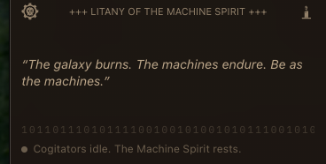

# Machine Spirit

A Warhammer 40k shrine pane for [Duckwork Desktop](https://github.com/DuckMind/duckwork), docked under the sessions list. The cogitators recite litanies to you, the tech-priest at the console. Just for fun.



- **Idle:** an Adeptus Mechanicus-style litany, renewed every 10 minutes and after each finished turn. Click the header or the litany for another one.
- **While Duckwork works:** the cog turns around the skull, the augmetic eye and the candle flame glow in your theme's accent colour, a binary stream scrolls, and a status line reports the cogitators' labours.
- **⌘K → "Recite a litany of the Machine Spirit"** shows one as a toast.
- The litanies are original lines written in the style, not quotes. Warhammer 40,000 is a trademark of Games Workshop; this is an unofficial fan project.

## Install

From the Duckwork plugin catalog (once listed):

```bash
duckwork plugins install machine-spirit
```

Or straight from this repository:

```bash
duckwork plugins install KuboKubis25/duckwork-machine-spirit
```

Then turn it on in Duckwork Desktop under **Capabilities → Plugins**. The pane appears under the sessions list.

You can also copy `desktop/plugin.js` by hand to `~/.duckwork/desktop-plugins/machine-spirit/plugin.js` on the machine running Duckwork Desktop. It loads within seconds; if not, press ⌘K and run **Reload desktop plugins**.

Closing its pane disables the plugin. Turn it back on in Capabilities → Plugins, or reset the layout.

## What it does and doesn't do

A pure renderer plugin: one `desktop/plugin.js` that uses only the Duckwork plugin SDK. No backend half, no agent tools or hooks, no network calls, no shell commands, no file access, nothing stored.

## Patterns worth copying

- `useValue(host.state.busy)` drives every animation.
- `data: { placement: 'left', dock: { pane: 'sessions', pos: 'bottom' }, height: '170px' }` docks the pane under the sessions list.
- The cog and candle animate with `requestAnimationFrame` and SVG transforms, so they still move when macOS "Reduce motion" turns off CSS animations.
- An SDK `atom` keeps the pane and the ⌘K command on the same litany.

## License

MIT
