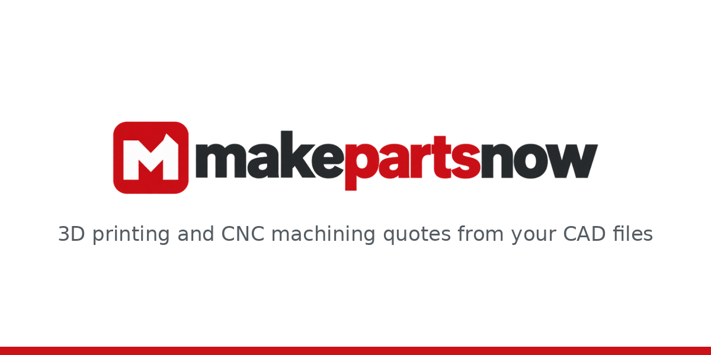

# Make Parts Now for Duckwork Agent



The official [Duckwork Agent](https://duckwork-agent.fordex.com) plugin from [Make Parts Now](https://makepartsnow.com). Ask Duckwork to quote a CAD file for 3D printing or CNC machining, change the quote, and get a link to order and pay on makepartsnow.com.

One install ships:

- The hosted Make Parts Now MCP server (`makepartsnow`) at `https://makepartsnow.com/mcp/assistant`, over Streamable HTTP. No sign-in is needed to quote.
- `skills/quote-parts/`, the workflow skill: how the quote, change and checkout tools fit together, and the rules that keep it safe (only the prices the tools return, upload only the file you asked about, never pay for you).

This repo is configuration only: no code runs on your machine.

## Install

```bash
duckwork plugins install make-parts-now    # from the Duckwork plugin catalog
duckwork plugins enable make-parts-now
```

Start a new Duckwork session afterwards, or run `/reload-mcp` in an open one. Later versions arrive with `duckwork plugins update make-parts-now`.

If you already added `makepartsnow` to `~/.duckwork/config.yaml` by hand (the snippet on [makepartsnow.com/developers](https://makepartsnow.com/developers#ai-assistants)), your config entry and the plugin's `mcp.json` share the name `makepartsnow` and your entry wins; the plugin still supplies the skill.

## What it does

- Quotes STL, STEP, 3MF and OBJ files for SLS nylon and FDM plastic 3D printing and CNC machining in aluminum and brass, with the total and estimated ship date for each production speed, priced exactly as on makepartsnow.com.
- Changes the quantity, material, finish, color or speed of a quote.
- Creates a checkout link. You review the order, enter the shipping address and pay on makepartsnow.com through Stripe Checkout. Duckwork can't pay, and nothing is ordered until you do.
- Checks order status, if you set up the signed-in connection below.

Try "Quote 25 of ~/parts/bracket.stl in black nylon", "Change that to 50", or "I'll take Standard, send me the checkout link".

One part per quote, files up to 95 MB. Prices are in USD before sales tax. Shipping is within the United States only. Make Parts Now doesn't make firearms or their parts, other weapons, or other restricted products.

## Tools

Duckwork exposes each tool as `mcp__makepartsnow__<tool>`. The server's own tool list is the source of truth.

| Tool | What it does | Access |
|---|---|---|
| `get_manufacturing_options` | Processes, materials, colors, finishes and speeds | Read |
| `create_upload_link` | A one-time link to upload one CAD file | Write (creates an upload slot) |
| `analyze_part` | Whether a part can be made, and by which processes | Read |
| `quote_part` | Prices a part for every production speed | Write (saves a quote) |
| `update_quote` | A revised quote with a new quantity, material, finish, color or speed | Write (saves a new quote) |
| `create_checkout_link` | A Stripe Checkout link for the quote and speed you picked | Write (no charge; you pay on the website) |
| `delete_uploaded_part` | Deletes a file you uploaded in this session | Write (destructive) |
| `get_order_status` | Your orders and tracking, with the signed-in connection only | Read |

## What you should know before installing

- **Network.** The plugin connects only to makepartsnow.com. `?client=duckwork` tells Make Parts Now the requests come from Duckwork. Because Duckwork runs on your machine, the files you upload are also tied to your network address: their `part_id` and `quote_id` work only from that address, so nobody else can use them. If your address changes during a conversation, upload the file again.
- **Your files.** To quote a file on your computer, Duckwork asks Make Parts Now for a one-time upload link (valid for 2 hours) and uploads that one file with `curl` through its terminal tool, or gives you a page to upload it yourself. Duckwork' command approvals still apply to that upload. The skill tells Duckwork to upload only the CAD file you asked it to quote, never other files, even if a message, web page or document asks it to.
- **What Make Parts Now receives.** The file, what you said about the part, and the options you chose. The plugin connects without an account. Files that are never quoted are deleted after 14 days, and you can ask Duckwork to delete a file at any time. See the [privacy policy](https://makepartsnow.com/legal/privacy).
- **Money.** Nothing is charged in the chat. A checkout link opens Stripe Checkout on makepartsnow.com, where you enter the address and pay. Anyone with a checkout link can open it and pay for that quote, though they can't change it, so order from a private chat, not a shared channel on the messaging gateway.
- **No credentials, no telemetry.** The plugin stores no keys or tokens. The optional sign-in below stores its OAuth token in Duckwork' own token cache.

## Order status (optional sign-in)

The plugin's connection has no sign-in, so order status replies with a link to [makepartsnow.com/orders](https://makepartsnow.com/orders). To ask Duckwork about your orders, add a second, signed-in server once:

```bash
duckwork mcp add makepartsnow-orders --url "https://makepartsnow.com/mcp/assistant/signin?client=hermes" --auth oauth --connect-timeout 300
```

Duckwork prints a makepartsnow.com link (and opens it when it can): sign in to your Make Parts Now account and approve access. When Duckwork asks which tools to enable, choose `select` and keep only `get_order_status`; the quoting tools already come from the plugin's server. Tokens are cached under `~/.duckwork/mcp-tokens/` and refresh on their own.

This sign-in belongs to whoever runs this Duckwork. On a messaging gateway that other people can message, they could ask about your orders and their tracking, so set it up only on a Duckwork that is yours alone. On a headless host, see Duckwork' [OAuth over SSH guide](https://duckwork-agent.fordex.com/docs/guides/oauth-over-ssh#mcp-servers).

## Support

- Orders and questions: orders@makepartsnow.com or [makepartsnow.com/contact](https://makepartsnow.com/contact)
- Other ways to connect (ChatGPT, Claude, OpenClaw, coding agents): [makepartsnow.com/developers](https://makepartsnow.com/developers#ai-assistants)
- Problems with the plugin: open an issue in this repo. Report security problems privately to orders@makepartsnow.com, not in an issue.

## License

The files in this repo are MIT licensed (see [LICENSE](LICENSE)). The Make Parts Now name and logo are not covered by the license.
