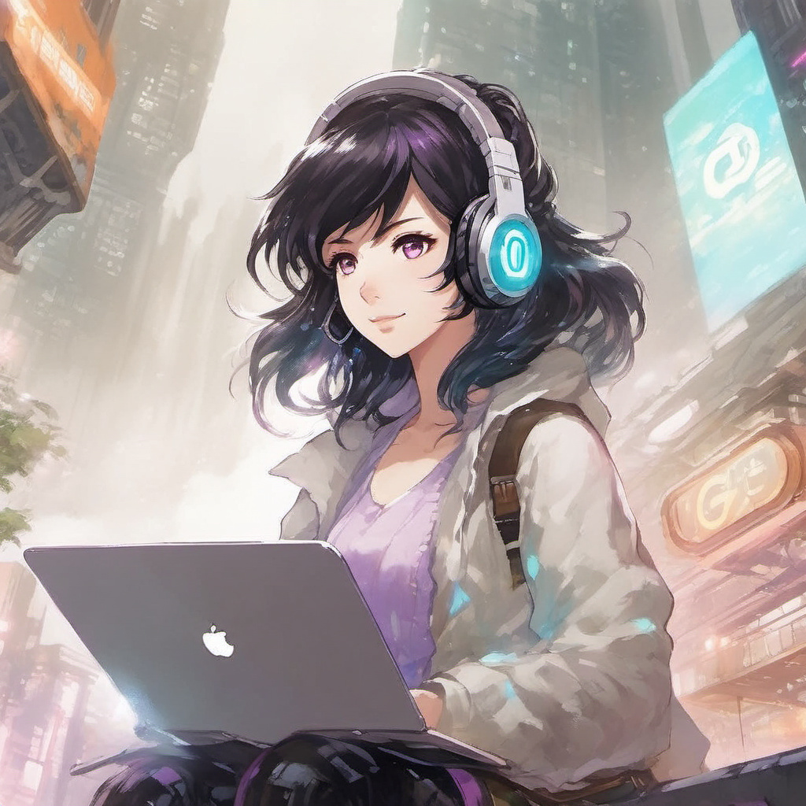

# duckwork-plugin-minimax-image

Image generation plugin for [Duckwork Agent](https://github.com/DuckMind/duckwork) using [MiniMax](https://platform.minimax.io).

Brings MiniMax's Image-01 models to Duckwork's `image_generate` tool. Supports both text-to-image and image-to-image generation with subject references.

## Example

Image-to-image generation with `image-01-live` -- anime character placed into a cyberpunk cityscape using subject reference:



## Models

| Model | Strengths |
|-------|-----------|
| `image-01` | Text-to-image generation (~5s) |
| `image-01-live` | Image-to-image with subject reference (~10s) |

## Install

```bash
duckwork plugins install rriggs/duckwork-plugin-minimax-image
duckwork plugins enable minimax
```

## Configure

All configuration lives under `image_gen.minimax` in `config.yaml`:

```yaml
image_gen:
  provider: minimax
  minimax:
    api: https://api.minimax.io
    key_env: MINIMAX_API_KEY
    model: image-01            # optional
```

| Key | Default | Description |
|-----|---------|-------------|
| `api` | `https://api.minimax.io` | MiniMax API base URL |
| `key_env` | `MINIMAX_API_KEY` | Name of the env var holding your API key |
| `model` | `image-01` | Default model for generation |

Set the API key in your `.env` file:

```bash
MINIMAX_API_KEY=***
```

No env var names are hard-coded -- `key_env` tells the plugin which env var to read.

## Usage

Once configured, Duckwork's `image_generate` tool routes through MiniMax automatically:

- **Text-to-image**: just provide a prompt
- **Image-to-image**: provide `image_url` (auto-upgrades to image-01-live)
  - Accepts URLs (`https://...`), data URIs (`data:image/png;base64,...`), or local file paths (`/path/to/image.png`) -- local files are automatically base64-encoded inline

Generated images are cached locally under `$DUCKWORK_HOME/cache/images/` since MiniMax URLs expire after ~24 hours.

## API Details

This plugin uses the MiniMax image generation API:

```
POST {api}/v1/image_generation
```

Both text-to-image and image-to-image use the same endpoint. Image-to-image adds a `subject_reference` array with `type: "character"` and the source image.

## Requirements

- Duckwork Agent v0.18+
- API key set in the env var named by `key_env`
- `requests` Python package (bundled with Duckwork)

## License

MIT