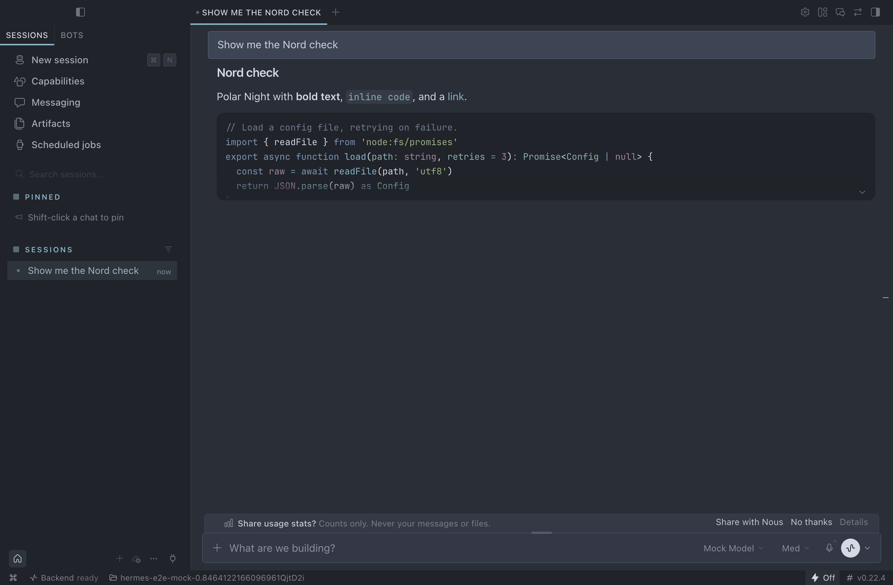
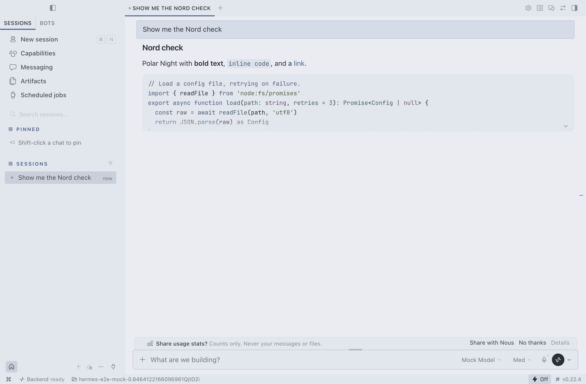
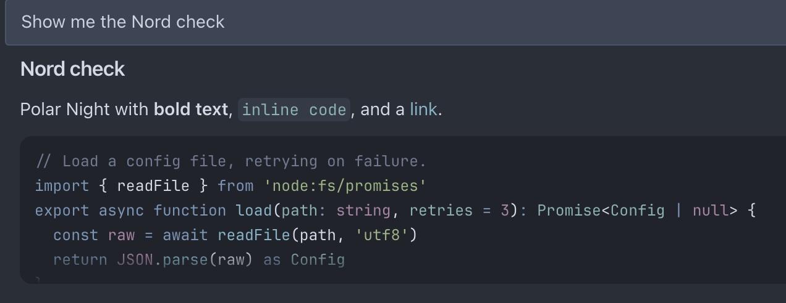
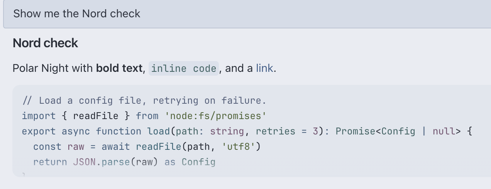

# Nord for Duckwork Desktop

An unofficial [Nord](https://www.nordtheme.com) theme for Duckwork Desktop.
It ships two hand-tuned palettes: Polar Night in dark mode and Snow Storm in light mode.
It is not affiliated with the Nord project or with Fordex.





## Install

```sh
duckwork plugins install nord-theme
```

Run this on the computer where Duckwork Desktop runs.
Then open Duckwork Desktop, go to Capabilities > Plugins, and turn on Nord Theme.

Turning the plugin on selects Nord once.
To go back, pick another theme in Settings > Appearance > Theme.
The plugin never switches the theme again after that first time.
Shift+X toggles between the dark and light palettes.

Update with `duckwork plugins update nord-theme`.
Remove with `duckwork plugins remove nord-theme`.

## What changes

- **Surfaces.** Every surface uses the real Nord colors.
  Duckwork normally blends theme surfaces toward a neutral grey; Nord turns that off while it is active.
- **Dark mode.** A recessed sidebar and code well (`#22272F`, one step below nord0), the chat on nord0, and the composer, cards and popovers on nord1.
- **Light mode.** The chat on nord6, the sidebar and code wells on nord5, and popovers one step above nord6.
- **Accent.** nord8 in dark mode.
  In light mode the accent is nord10 with its lightness lowered until it reaches 4.5:1 contrast on the sidebar; plain nord10 measures 3.3:1.
- **Text.** Primary text lands exactly on nord4 (dark) and nord0 (light).
- **Code blocks.** Syntax colors follow Nord, mapped role by role from its official VS Code theme.
  In dark mode, comments are brightened slightly so they stay readable at small sizes.
- **Status colors.** Success, warning, error and the other status colors use Aurora and Frost.
- **Selection and inline code.** Frost selection, nord7 inline code.
- **Terminal.** Nord's ANSI colors in dark mode, with bright black raised to nord3 bright so dim output stays visible.
  Nord has no light terminal palette, so light mode uses the Nord hues darkened to 4.5:1 on nord6.





## How it works

The plugin uses only the Duckwork Desktop plugin SDK.
It registers one theme, named `nord`, through `THEMES_AREA`.
The theme carries both palettes, both terminal palettes, and a stylesheet.
Duckwork applies the stylesheet only while Nord is the selected theme.
Under any other theme, the plugin draws nothing.

## Disclosure

- The plugin selects Nord once, on the first load after install, and stores a flag in plugin storage so it never does it again.
- Its stylesheet recolors Duckwork Desktop surfaces, code-block syntax colors, status colors, text selection and inline code, only while Nord is selected.
- It makes no network calls, reads no files, runs no shell commands and stores no credentials.

## Known limits

- **A short flash at startup.** When Duckwork Desktop starts, it shows its default theme for about 0.1 s before Nord appears.
  Duckwork loads plugins after its first paint, so a plugin theme does not exist yet when the window first draws.
  Built-in and imported themes are cached and do not have this delay.
- **Markup changes.** The stylesheet targets Duckwork Desktop's markup and color variables.
  If an update changes them, the affected part falls back to Duckwork' own look instead of breaking.
  Please open an issue with a screenshot and your `duckwork --version`.
- **Window translucency.** With translucency on, the desktop shows through the sidebar and tints it.
  Turn translucency off in Settings > Appearance to see the exact Nord colors.
- **Name.** Do not create a CLI skin named `nord`.
  An active skin with the same name replaces this theme in Duckwork Desktop.

Last verified with Duckwork Agent v0.22.4.

## Credits and license

MIT. See [LICENSE](LICENSE).

The Nord palette is Copyright (c) 2016-present Sven Greb (Arctic Ice Studio), MIT.
See [nordtheme/nord](https://github.com/nordtheme/nord).
