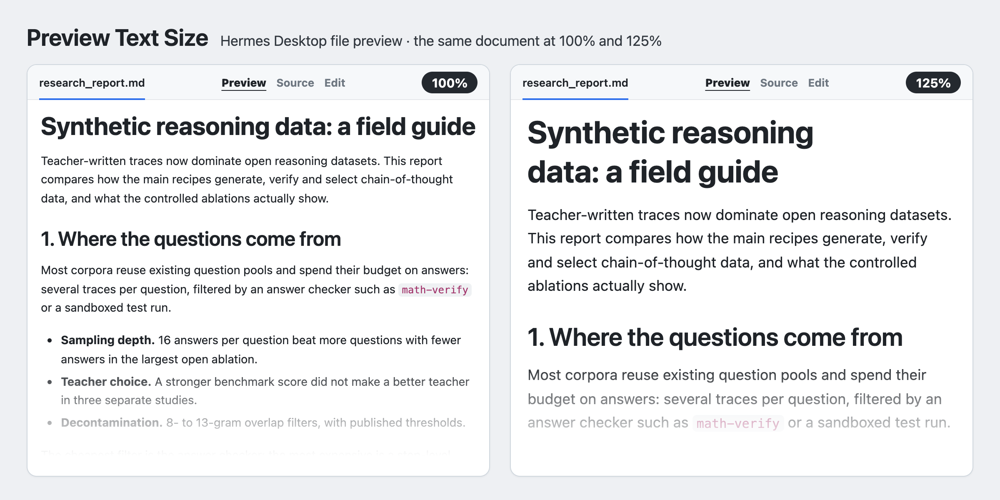

# Preview Text Size — Duckwork Desktop plugin



Changes the text size of the file preview pane in Duckwork Desktop.

Duckwork Desktop has two size controls: **Chat Text Size**, which covers the transcript and the composer, and **UI Scale** (⌘+ / ⌘−), which zooms the whole window. Neither changes the file preview on the right, so a long Markdown report there stays small. This plugin scales only the rendered Markdown in that pane, from 90% to 175%. Chat, sidebar and the rest of the window keep their size.

## Install

From the Duckwork plugin catalog: Duckwork Desktop → **Capabilities → Plugins**, search **preview-text-size**, install. Or from a terminal:

```bash
duckwork plugins install preview-text-size
```

Or install straight from this repository:

```bash
duckwork plugins install pandengyao/duckwork-preview-text-size
```

The app copies `desktop/plugin.js` into `~/.duckwork/desktop-plugins/`. After a terminal install, click **Rescan** in Capabilities → Plugins (or restart the app). The plugin starts disabled: flip its switch there to enable it.

## Use

- **Settings → Appearance → Preview Text Size**: pick 90%, 100%, 110%, 125%, 150% or 175%.
- **Command palette (⌘K)**: *Preview text: larger*, *Preview text: smaller* and *Preview text: reset to 100%*. Each row shows the current size.
- **Shortcuts**: on macOS ⌘⌥= makes it larger, ⌘⌥- smaller and ⌘⌥0 resets it. If macOS Accessibility Zoom's keyboard shortcuts are turned on, the system takes ⌘⌥= and ⌘⌥- for screen zoom first, so rebind them in **Settings → Keyboard Shortcuts**. On Windows and Linux they start unbound, because Ctrl+Alt is AltGr on many keyboard layouts; bind them in **Settings → Keyboard Shortcuts**.

The size you pick is remembered across restarts and applies to every open Duckwork window. It starts at 100%, which looks exactly like the app without the plugin.

Labels are in English and Simplified Chinese. Other languages fall back to English.

## Scope and limits

- It scales the **Preview** view of Markdown files. The **Source** and **Diff** views keep their size, because their rows are virtualized at a fixed line height.
- It works by setting CSS `zoom` on the preview's `[data-preview-markdown]` element. If a later Desktop release renames that attribute, the plugin stops having an effect. It cannot break the preview.

## What it does on your machine

- No network calls, shell commands, background processes, credentials or telemetry.
- Stores one setting, the chosen size, in the app's plugin storage (`duckwork.plugin.preview-text-size.scale` in local storage).
- Appends one `<style>` element to the Desktop window and removes it when the plugin is disabled.

## Layout

- `desktop/plugin.js` — the plugin. Plain ESM that only imports `@duckwork/plugin-sdk` and `react/jsx-runtime`. There is no build step; this file is what ships.
- `plugin.yaml` — the manifest the catalog and `duckwork plugins` read.
- `test/plugin.test.mjs` — headless tests with no dependencies: `node test/plugin.test.mjs` (Node 20+).
- `docs/before-after.png` — the image above, rendered from `docs/before-after.html` with the preview pane's own font sizes, line height and width and the plugin's exact CSS rule at 125%.

## SDK

Everything comes from `@duckwork/plugin-sdk`: `APPEARANCE_AREAS`, `PALETTE_AREA`, `KEYBINDS_AREA`, `ListRow`, `SegmentedControl`, `usePluginI18n`, `useValue`, `atom` and `haptic`, plus `ctx.storage`, `ctx.i18n`, `ctx.onDispose` and `ctx.addEventListener`. Reference: https://duckwork-agent.fordex.com/docs/developer-guide/desktop-plugin-sdk

MIT.
