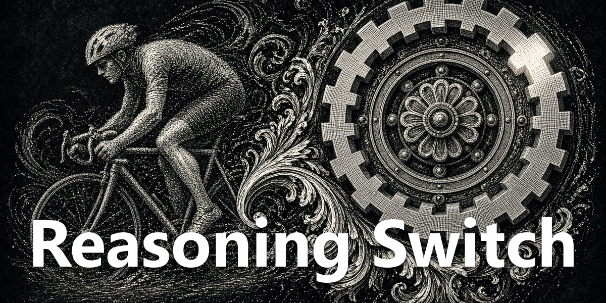

<div align="center">
  <a href="https://github.com/DuckMind/duckwork"></a>
  <h1>Reasoning Switch</h1>
  <strong>Cycle reasoning effort from the status bar.</strong>
  <p>Colors and per-level prompt demote make the current setting visible. Lives in the repo but is <strong>not</strong> in the pack and stays off by default.</p>
  <p>
    <a href="plugin.yaml"></a>
    <a href="../../LICENSE"></a>
  </p>
</div>

<div align="center">
  
</div>

## What You Can Do

- Click the status-bar word to advance through the levels you chose.
- Pick from `none`, `minimal`, `low`, `medium`, `high`, `xhigh`, `max`, and `ultra`.
- Demote a level after a chosen number of user prompts (for example High for three prompts, then Medium).
- Change the focused session only. The global profile default stays put.

## Install

**Not included in `duckwork-pack.yaml`.** Default off. Install it on its own:

```bash
duckwork plugins install apoapostolov/duckwork-agent-awesome-plugins/public/reasoning-switch
```

Requires [Duckwork Agent](https://github.com/DuckMind/duckwork) **0.21.0 or newer**. Enable **Reasoning Switch** under **Capabilities → Plugins**. Use the status-bar word to cycle; open its gear for levels, colors, and limits.

## Requirements / Limits

Desktop-only. Available levels follow what the connected Duckwork backend accepts.

## License

[MIT](../../LICENSE)
