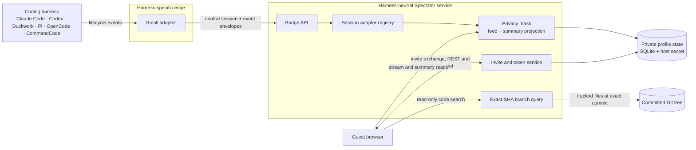
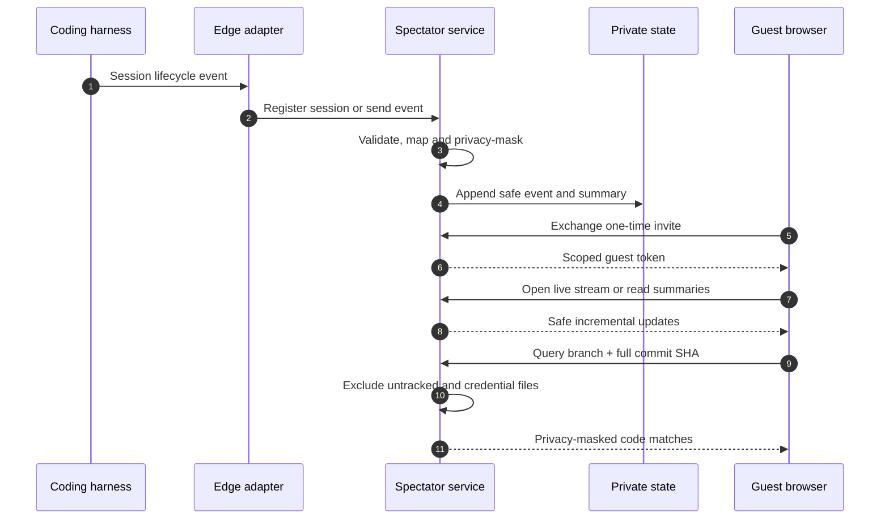

# Spectator

Spectator lets a guest follow a coding-agent session without exposing the raw transcript.

It provides:

- a live session stream;
- continuously updated summary entries;
- read-only search of an exact committed branch snapshot.

The core is harness-neutral. Small edge adapters connect Claude Code, Codex, Duckwork, Pi, OpenCode, CommandCode and similar hook-based environments.

## Status

- Version: `0.3.0`
- Plugin name: `spectator`
- License: MIT
- UI: production broadcast-studio interface with responsive light and dark themes

## Architecture

### Component view



**Key:** rectangular boxes are runtime components; cylinders are stored data; the adapter is the only harness-specific layer. Raw transcript content does not cross into guest storage.

### Session-sharing workflow



**Key:** the adapter authenticates with the local host secret; the browser uses a scoped guest token. Branch queries are read-only and pinned to one commit.

## Requirements

- Python 3.11+
- Git
- `uv` for the documented setup and verification commands
- A Git repository for branch queries

## Install

### Standalone service

```bash
uv venv .venv
uv pip install -e . --python .venv/bin/python
.venv/bin/spectator-serve
```

The service binds to `127.0.0.1:8788` and mounts its API at:

```text
http://127.0.0.1:8788/api/plugins/spectator/
```

The package also installs:

- `spectator-hook`
- `spectator-integrations`

### Duckwork directory plugin

Duckwork accepts Git-backed plugin installs:

```bash
duckwork plugins install OWNER/REPOSITORY
```

For local development, place the complete checkout at:

```text
$DUCKWORK_HOME/plugins/spectator/
```

Keep `plugin.yaml`, root `__init__.py`, `dashboard/` and `src/` together. Restart the Duckwork gateway or dashboard after installation. Local paths are not accepted by `duckwork plugins install`; they are treated as Git identifiers.

The wheel also exposes the `spectator.duckwork_plugin` entry point in the `duckwork_agent.plugins` group.

## Runtime state

Spectator stores private state under the active Duckwork profile:

```text
$DUCKWORK_HOME/data/spectator/
```

If `DUCKWORK_HOME` is unset, the path is `~/.duckwork/data/spectator/`. Set `SPECTATOR_DATA_DIR` to use another safe directory.

### State policy for 0.2.0: start fresh

Version `0.2.0` does not read, copy or migrate legacy state from `~/.duckwork/plugins/spectator/`.

- Legacy files remain untouched.
- A new host secret is created in the profile-local data directory.
- Old invites do not work with the new state.
- Preserving legacy state requires a separate, reviewed migration. Do not point the new runtime at the legacy plugin-source directory.

The decision record is in [`docs/adr/0001-fresh-profile-local-state.md`](docs/adr/0001-fresh-profile-local-state.md).

## Connect a coding harness

List the shipped templates:

```bash
.venv/bin/spectator-integrations list
```

Print one template:

```bash
.venv/bin/spectator-integrations show claude-code
.venv/bin/spectator-integrations show codex
.venv/bin/spectator-integrations show commandcode
.venv/bin/spectator-integrations show opencode
.venv/bin/spectator-integrations show pi
```

Merge the result into existing harness settings; do not overwrite unrelated hooks.

| Harness | Integration location |
|---|---|
| Claude Code | `.claude/settings.json` or `~/.claude/settings.json` |
| Codex | `.codex/hooks.json` or `~/.codex/hooks.json` |
| CommandCode | `.commandcode/settings.json` or user settings |
| OpenCode | `.opencode/plugins/spectator.ts` |
| Pi | `~/.pi/agent/extensions/spectator.ts` |
| Duckwork | Native plugin entry point or directory plugin |
| Other hook-based tools | `spectator-hook` HTTP bridge command |

Hook configuration:

- `SPECTATOR_BASE_URL`: defaults to `http://127.0.0.1:8788`
- `SPECTATOR_HOST_SECRET`: host-secret file path; defaults to the active Spectator data directory
- `SPECTATOR_OWNER_LABEL`: defaults to `Shared session`

The hook fails open by default: if Spectator is unavailable, the coding harness continues. Use `--strict` only for diagnostics.

## Create and join an invite

1. Start `spectator-serve`.
2. Start the coding harness with its Spectator adapter enabled.
3. List sessions with `GET /bridge/sessions`.
4. Mint an invite with `POST /invites` and the chosen `session_id`.
5. Give the guest this URL:

```text
http://127.0.0.1:8788/api/plugins/spectator/guest.html#invite=<raw-token>
```

The URL fragment is not sent in the HTTP request line. The browser exchanges it once for a scoped guest token.

## Main API

All routes are under `/api/plugins/spectator`.

| Method | Route | Purpose | Auth |
|---|---|---|---|
| `GET` | `/status` | Service status | Host |
| `GET` | `/bridge/sessions` | List registered sessions | Host |
| `PUT` | `/bridge/session` | Register or refresh a session | Host |
| `DELETE` | `/bridge/session/{session_id}` | Remove a portable session | Host |
| `POST` | `/bridge/events` | Ingest privacy-safe events | Host |
| `POST` | `/invites` | Mint an invite | Host |
| `POST` | `/invites/join` | Exchange an invite | Invite token |
| `GET` | `/session` | Read session metadata | Host or guest |
| `GET` | `/stream` | Read cursor-based events | Host or guest |
| `GET` | `/summary-entries` | Read projected summaries | Host or guest |
| `POST` | `/code/query` | Search the committed snapshot | Host or guest |
| `WS` | `/events` | Receive live events | First-frame guest auth |

Legacy feed and governed-suggestion routes remain for compatibility. Suggestion injection is exposed only when a real Duckwork injection capability is configured.

## Security and privacy

- Raw prompts, assistant messages, tool arguments and tool output are not persisted in the guest feed.
- Free-text labels are privacy-masked before storage or return.
- Absolute and home-relative paths are fully hidden.
- Known AWS access-key identifiers and secret-shaped values are masked.
- Suggestion content is bounded at the HTTP model and again by its UTF-8 byte size in the gate.
- Branch queries require an exact branch and full commit SHA.
- Untracked files and known credential files are excluded.
- Returned code snippets pass through the privacy mask.
- Invite tokens are stored as hashes and returned raw only when minted.
- On POSIX, the runtime directory is `0700`; `spectator.db` and `host_secret` are `0600`.
- Storage below an unsafe group/world-writable non-sticky parent is rejected.
- Remote exposure is disabled by default.

Do not expose Spectator directly to a network without TLS and an authenticated tunnel or reverse proxy.

## Configuration

Create `$DUCKWORK_HOME/data/spectator/config.yaml`:

```yaml
spectator:
  pending_ttl_seconds: 300
  invite_ttl_seconds: 86400
  allow_remote: false
  require_tls: true
  feed_source: auto
  poll_interval_seconds: 2
  max_pending_suggestions: 100
  event_retention_days: 7
  allow_gateway_injection: false
  inject_timeout_seconds: 2.0
```

## Verify

The repo includes `.duckwork/environment.json`, which pins Duckwork verification to the real app target and public readiness page.

Inspect the recipe:

```bash
duckwork verify --detect-only --json
```

Run the full repository recipe:

```bash
duckwork verify --json
```

Manual development checks:

```bash
.venv/bin/python -m pytest -q
uvx ruff check src dashboard tests
uvx mypy src/spectator dashboard/plugin_api.py
```

The release gate also checks the built wheel, dependencies, security scans, the real Duckwork loader, HTTP/WebSocket behaviour and private file permissions.

## License

MIT. See [`LICENSE`](LICENSE).
