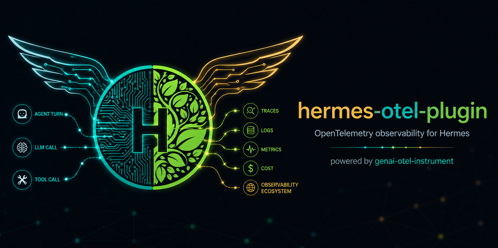
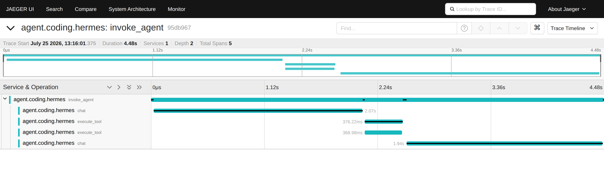
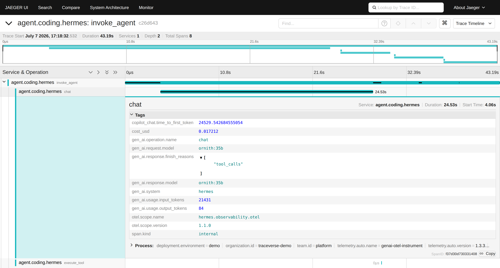
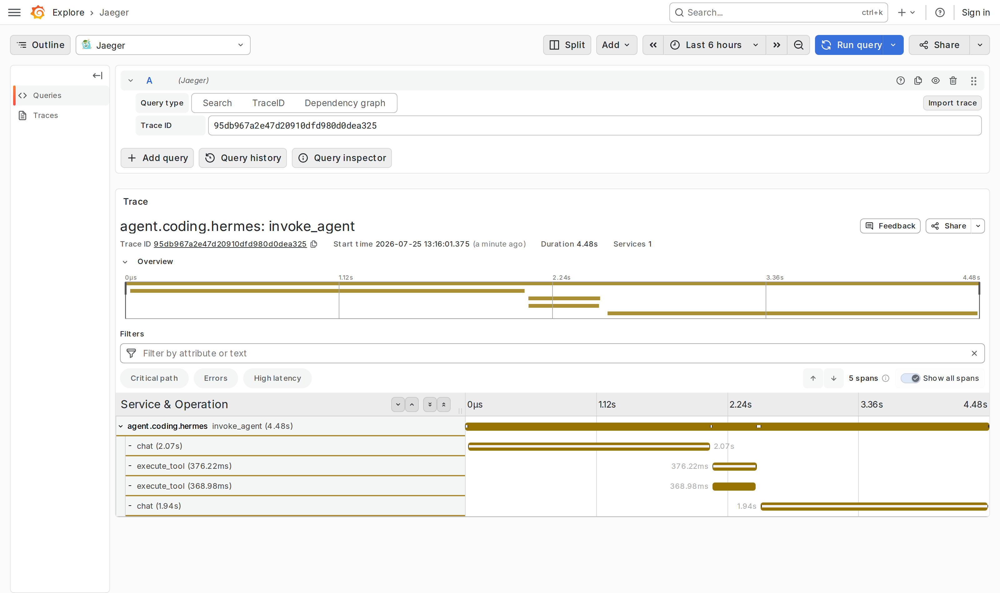
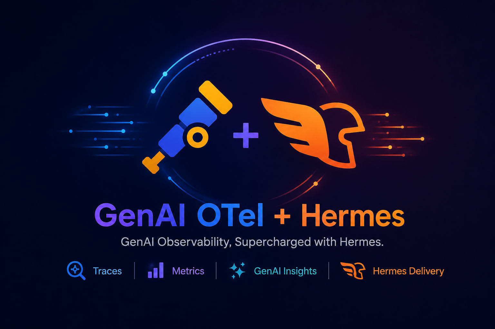

<p align="center">
  
</p>

# duckwork-otel-plugin — OpenTelemetry (OTLP) Observability for Duckwork

A native **OpenTelemetry** observability plugin for the
[Duckwork agent](https://github.com/DuckMind/duckwork).

This is a real Duckwork turn in a stock Jaeger — one `invoke_agent` span per
turn, a `chat` span per LLM call (with its measured latency), and an
`execute_tool` span per tool call:

<p align="center">
  
</p>

Every span carries the GenAI-convention attributes — model, tokens, cost,
latency — so any conventions-aware backend can aggregate them:

<p align="center">
  
</p>

The same trace in **Grafana** (Explore → Jaeger datasource) — any OTLP
backend works:

<p align="center">
  
</p>

It exports Duckwork's built-in observability events over OTLP in three
complementary ways:

1. **GenAI-convention spans** (`gen_ai.*`) — the standard trace model, so Duckwork
   telemetry flows to *any* OpenTelemetry backend (an OpenTelemetry Collector,
   Jaeger, Grafana Tempo, Honeycomb, …) with no vendor lock-in.
2. **Dashboard-shaped OTLP log records** — the `user_prompt` / `session_start` /
   `api_response` / `tool_result` event model that agent-coding dashboards (the
   kind Claude Code / Codex / Copilot populate) aggregate on, so a Duckwork
   session shows up in the Activity / Sessions / Leaderboards views — including
   its prompts — like any other coding agent.
3. **Local-model cost** — when the backend returns no price (Ollama / HF / vLLM
   local models), cost is estimated from the model's parameter size, so spans
   and log records carry a real `cost_usd` instead of `$0`.

Standalone and **opt-in** — it only loads when you explicitly enable it, and it
makes no changes to Duckwork core. Without the OTel SDK the hooks no-op silently
(the plugin fails open).

> Published as a standalone plugin per Duckwork's
> [contribution policy](https://github.com/DuckMind/duckwork)
> that third-party observability backends live outside the core tree
> (see [duckwork-agent#48184](https://github.com/DuckMind/duckwork)).

## Install

Choose one install path. The catalog key is `traceverse-duckwork-otel`; the plugin's enable key is `traceverse_duckwork_otel`.

### A. Duckwork plugin catalog (recommended once listed)

```bash
duckwork plugins install traceverse-duckwork-otel
duckwork plugins enable traceverse_duckwork_otel
```

### B. Direct GitHub install (available before catalog approval)

```bash
duckwork plugins install Mandark-droid/duckwork-otel-plugin
duckwork plugins enable traceverse_duckwork_otel
```

### C. pip (entry-point discovery)

```bash
pip install git+https://github.com/Mandark-droid/hermes-otel-plugin.git
# then add `traceverse_duckwork_otel` to plugins.enabled in ~/.duckwork/config.yaml, or:
duckwork plugins enable traceverse_duckwork_otel
```

### D. Manual clone into `~/.duckwork/plugins/`

```bash
git clone https://github.com/DuckMind/duckwork ~/.duckwork/plugins/traceverse_duckwork_otel
duckwork plugins enable traceverse_duckwork_otel
```

## Quickstart

```bash
# 1. Install the OTel SDK + OTLP HTTP exporter (the only hard dependency)
pip install opentelemetry-sdk opentelemetry-exporter-otlp-proto-http

# 2. Install + enable the plugin (direct GitHub install works before catalog approval)
duckwork plugins install Mandark-droid/duckwork-otel-plugin
duckwork plugins enable traceverse_duckwork_otel

# 3. Send a turn, then look for an "invoke_agent" trace in your OTel backend
duckwork chat -q "hello"
```

It works out of the box against a local collector on `http://localhost:4318`.

### Configure (optional)

All configuration is optional. Set these in `~/.duckwork/.env`:

```bash
DUCKWORK_OTEL_SERVICE_NAME=agent.coding.duckwork   # service.name (backends group on this)
DUCKWORK_OTEL_ENDPOINT=http://localhost:4318     # OTLP HTTP endpoint
DUCKWORK_OTEL_AGENT_NAME=duckwork                  # gen_ai.agent.name
DUCKWORK_OTEL_CAPTURE_CONTENT=false              # attach prompt/response text (privacy-gated)
DUCKWORK_OTEL_LOGS_ENABLED=true                  # set false for spans-only OTLP receivers (no /v1/logs): skips the dashboard log pipeline entirely
DUCKWORK_OTEL_USER_ID=                           # stamp user.id on the resource
```

Standard OTel env vars are honoured as fallbacks: `OTEL_SERVICE_NAME`,
`OTEL_EXPORTER_OTLP_ENDPOINT`. Prompt / response / tool I/O is attached **only**
when `DUCKWORK_OTEL_CAPTURE_CONTENT=true` (privacy-gated, off by default).

### Verify / disable

```bash
duckwork plugins list                 # traceverse_duckwork_otel should show "enabled"
duckwork plugins disable traceverse_duckwork_otel
```

## Architecture

```
invoke_agent        per Duckwork turn   (gen_ai.conversation.id = session id)
  ├── chat          per LLM API call  (tokens, cost, finish reason, TTFT)
  └── execute_tool  per tool call     (gen_ai.tool.name / .type, errors)
```

`gen_ai.system = duckwork` on every span; `service.name` defaults to
`agent.coding.duckwork`. Spans and dashboard log records are emitted in parallel
(a logs failure never disables spans). Identity (`service.name`, `user.id`, and
any `team.id` / `organization.id` from `OTEL_RESOURCE_ATTRIBUTES`) is placed on
the OTel **resource** so per-user / per-org leaderboard aggregations work.

**Real span durations.** Duckwork's per-call hooks fire *after* each LLM/tool
call and carry the measured wall-clock time (`api_duration` /  `duration_ms`).
Since v1.1.0 the plugin backdates each `chat` / `execute_tool` span start by
that measured duration, so waterfalls show the true call windows — not
zero-length ticks at the completion instant.

The mapping logic is pure, Duckwork-agnostic, and unit-tested with in-memory
exporters (no Duckwork, no network) under `tests/test_otel_plugin.py`. The
**full reference lives inline, next to the code** — each module's docstring is
the source of truth:

| Module | What its docstring documents |
|--------|------------------------------|
| `emitter.py` | GenAI **span** model (`invoke_agent` / `chat` / `execute_tool` + attributes) |
| `log_emitter.py` | dashboard **log-record** model (`user_prompt` / `session_start` / `api_response` / `tool_result` — the field contract dashboards aggregate on) |
| `cost.py` | local-model **cost estimation** (model-size → price-tier methodology) |
| `provider.py` | tracer / logger **bootstrap** (genai_otel preferred, plain OTel SDK fallback) |
| `__init__.py` | the only Duckwork-coupled module: `register(ctx)` + lifecycle hooks |
| `plugin.yaml` | manifest |

## Advanced — GPU / CO2 / eval metrics

<p align="center">
  
</p>

Installing `genai-otel-instrument` instead of the plain OTel SDK unlocks on-prem
**GPU / energy / CO2** metrics and an inline **eval suite** (PII, toxicity, bias,
prompt-injection, restricted-topics, hallucination) — scored in-process, on-prem,
with no data leaving the host, no SaaS backend, and no separate eval service.
It is driven entirely by `genai_otel`'s own `GENAI_*` environment variables;
**no plugin code change is required**.

→ See **[ADVANCED.md](./ADVANCED.md)** for the full setup: why `genai_otel` vs a
vanilla OTel SDK (with a capability comparison), the install extras, the
environment recipe, and exactly what attributes/metrics you get.

## For AI agents

A machine-readable summary of this plugin's contract (also see
[`llms.txt`](./llms.txt)). Everything below is stable API; the per-module
docstrings are the authoritative deep reference.

```yaml
name: traceverse-duckwork-otel
purpose: Export Duckwork agent telemetry over OTLP (OpenTelemetry GenAI conventions)
install:
  recommended: ["duckwork plugins install traceverse-duckwork-otel",
                "duckwork plugins enable traceverse_duckwork_otel"]
  direct_fallback: "duckwork plugins install Mandark-droid/duckwork-otel-plugin"
  runtime_dependency: "pip install opentelemetry-sdk opentelemetry-exporter-otlp-proto-http"
verify: "duckwork plugins list   # 'traceverse_duckwork_otel' shows enabled; then send one turn and look for an invoke_agent trace"
config_env:                                # all optional; set in ~/.duckwork/.env
  DUCKWORK_OTEL_SERVICE_NAME: "service.name resource attr (default agent.coding.duckwork)"
  DUCKWORK_OTEL_ENDPOINT: "OTLP HTTP endpoint (default http://localhost:4318)"
  DUCKWORK_OTEL_AGENT_NAME: "gen_ai.agent.name (default duckwork)"
  DUCKWORK_OTEL_CAPTURE_CONTENT: "true attaches prompt/response/tool I/O text (default false, privacy-gated)"
  DUCKWORK_OTEL_LOGS_ENABLED: "false skips the dashboard log-record pipeline entirely — for spans-only OTLP receivers without /v1/logs (default true)"
  DUCKWORK_OTEL_USER_ID: "stamps user.id on the OTel resource"
span_model:
  invoke_agent: "one per Duckwork turn; parent; gen_ai.conversation.id + session.id = session id"
  chat: "one per LLM API call; child; real measured duration (backdated start)"
  execute_tool: "one per tool call; child; real measured duration (backdated start)"
key_attributes:
  - gen_ai.operation.name        # invoke_agent | chat | execute_tool
  - gen_ai.system                # always "duckwork"
  - gen_ai.request.model / gen_ai.response.model
  - gen_ai.usage.input_tokens / gen_ai.usage.output_tokens
  - gen_ai.response.finish_reasons   # array; [0] is the primary reason
  - gen_ai.tool.name / gen_ai.tool.type
  - cost_usd                     # real or size-tier-estimated for local models
  - copilot_chat.time_to_first_token  # measured API latency, ms
log_events: [user_prompt, session_start, api_response, tool_result]  # OTLP log records, dashboard-shaped
guarantees:
  - "fail-open: without the OTel SDK every hook no-ops; observability never breaks the agent"
  - "no Duckwork core changes; hooks only"
  - "content capture is opt-in (DUCKWORK_OTEL_CAPTURE_CONTENT), off by default"
```

## Development

```bash
pip install opentelemetry-sdk opentelemetry-exporter-otlp-proto-http pytest pyyaml ruff
pytest tests/ -v       # 44 tests, in-memory exporters, no network
ruff check .
```

## License

[MIT](./LICENSE)
