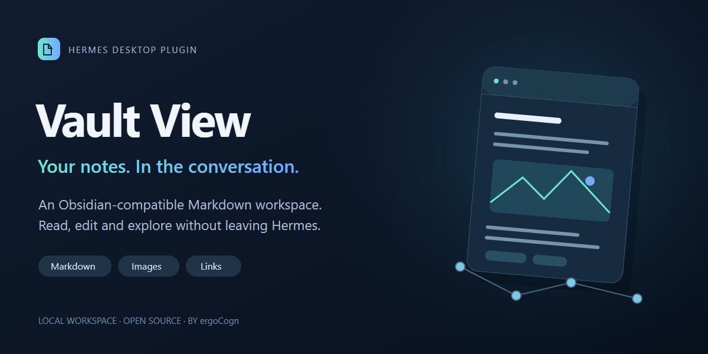
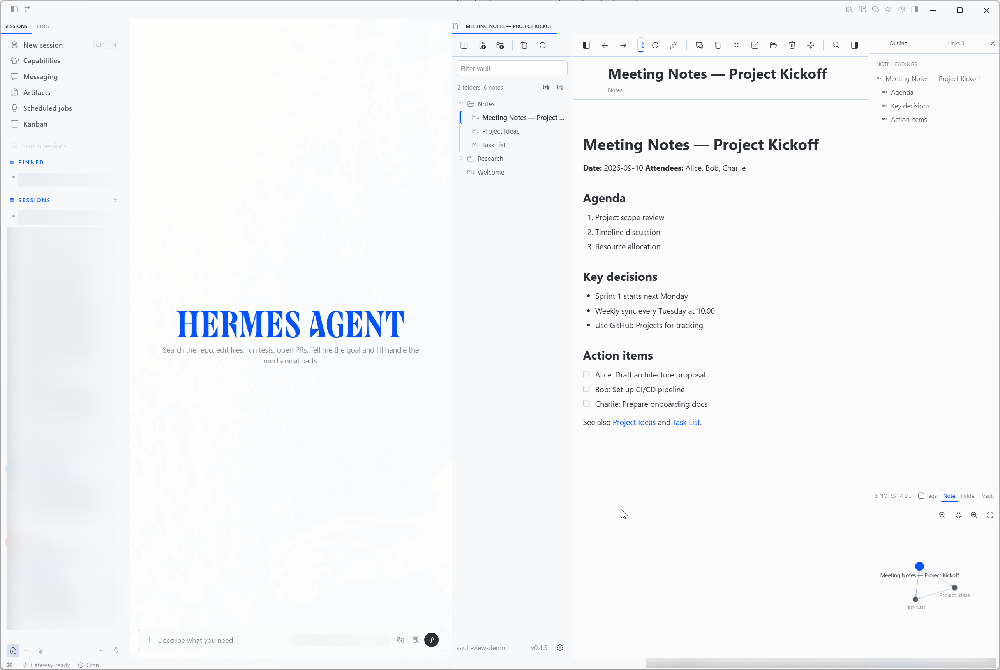
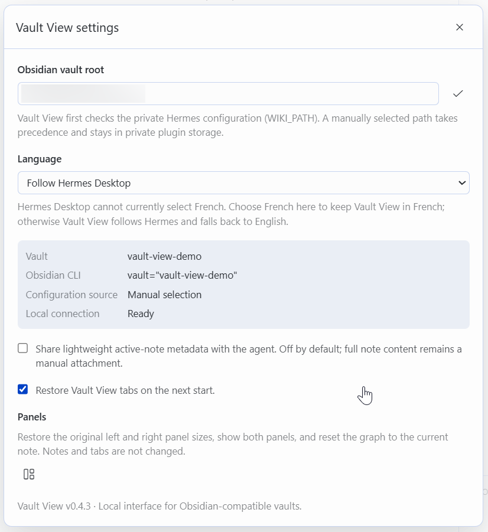

# Vault View

**Your Obsidian-compatible vault, directly inside Duckwork Desktop.**

[English](README.md) · [Français](README.fr.md)

Vault View brings your Markdown knowledge base into the conversation. Find a note, ask Duckwork to create or update it, follow its links, and keep several notes open in a workspace designed for a vault—not a generic file preview.

## What is new in 0.5.0

- Keep an optional workspace for each conversation, including its open and closed tabs, active note, navigation, editing state, previews and unsaved drafts. Pin several tabs globally when they should remain visible across conversations.
- Quote an explicit note selection into the active Duckwork conversation from reading, visual editing or Markdown source. The user action inserts a Markdown block quote and never persists the selection.
- Create or open a note directly from a localized empty-workspace card, and keep the global Vault View toggle available even when no note is open.
- Wrap the main and formatting toolbars at narrow container widths and align controls, menus, dialogs, focus states and empty cards with Duckwork theme variables.
- Migrate legacy tab state into versioned workspace storage without changing notes or attachments.

## Previous catalog review corrections in 0.4.8 and 0.4.7

- Keep the plugin inside its own UI root, use public workspace APIs and preserve the direct-install entry point.
- SDK-sandboxed web previews, with Duckwork >=0.21.5 required.
- Separate agent navigation guidance and remote-image settings, both off by default.
- Complete English/French errors, dialogs, bridge messages and formatting defaults.

- Reliable chunked reading and verified saves for long notes.
- Faster navigation with bounded, revision-aware caches and progressive reading.
- Live Markdown styling, source preservation, tag search and responsive sidebars.
- Lazy image previews, a detail viewer, and image/text/code attachment previews.
- Shared note tabs, editing undo/redo and private incident diagnostics.

Raster thumbnails use ffmpeg when available; original images remain available as a fallback. The filesystem transport requires Unix/WSL shell utilities. Direct Obsidian opening is temporarily hidden; external application opening depends on the host/backend configuration. Native Windows/macOS launch validation remains incomplete.

See [CHANGELOG.md](CHANGELOG.md) for the complete changes and [AGENTS.md](AGENTS.md) for the public AI contribution guide.

## Find. Create. Navigate.

| Search the vault | Create and edit | Explore connections |
| --- | --- | --- |
| Search notes, browse folders, filter tags, and inspect links. | Write directly or ask Duckwork to work through its configured Obsidian CLI. | Follow wikilinks, use Back and Forward, open tabs, or jump through the graph. |

## Features

- Visual reading and Markdown editing
- Note and folder creation, renaming, moving, and deletion
- Search, explorer, outline, tags, backlinks, outgoing links, and vault graph
- Wikilinks, Obsidian callouts, and local images
- Multiple tabs with independent navigation history
- Explicitly quote a selected note passage into the active conversation
- Optional per-conversation workspaces (off by default), with multiple globally pinned tabs
- Responsive toolbars that wrap to the actual Vault View container width
- Automatic refresh after changes made by Duckwork, Obsidian CLI, or another editor
- Light and dark Duckwork theme support
- English, French, or automatic Duckwork Desktop language selection
- Icon-first controls with localized labels and tooltips

## How it works with Duckwork

The Duckwork agent keeps using its existing Obsidian CLI integration for note operations. Vault View provides the user-facing display and replaces the generic preview for Obsidian-related work. It can show one note, open several notes at once, or stay hidden for background-only operations.

The root `plugin.js` remains the standalone entry point. `plugin.yaml` contains catalog metadata only; `desktop/plugin.js` is an identical Desktop entry point for catalog installation. There is no Python component, Agent tool, or runtime dependency added.

## Installation

Vault View is a standalone Duckwork Desktop Plugin. It requires no build step, npm package, or Python component.

### One-click installation

Open this page on the computer running Duckwork Desktop, then select **Install in Duckwork Desktop**:

[**Install Vault View in Duckwork Desktop**](duckwork://plugin/install?repo=ergocogn/duckwork-desktop-plugin-vault-view)

Duckwork asks for confirmation before installing. If the link is not available in your Duckwork Desktop version, use the manual installation below.

### Manual installation

1. Copy this repository into the active Duckwork Desktop plugin directory as `vault-view`.
2. Confirm that the entry point is `$DUCKWORK_HOME/desktop-plugins/vault-view/plugin.js`.
3. Reload Desktop Plugins in Duckwork Settings.
4. Enable **Vault View**.

Use the plugin directory shown by Duckwork Desktop. The Desktop application and its backend may use different locations, especially with WSL or a virtual machine.

## Configuration

Vault View automatically looks for the vault already configured through Duckwork `WIKI_PATH`. If no valid `.obsidian` vault is found, select its root in the settings panel.

The language setting offers **Follow Duckwork Desktop**, **English**, and **Français**. The same panel controls tab restoration, optional per-conversation workspaces, panel layout, optional active-note metadata sharing, agent navigation guidance and remote images. Per-conversation workspaces are off by default; when enabled, each conversation retains its own open/closed tabs and drafts, while pinned tabs remain visible everywhere. All sharing/network options are independent and disabled by default.

Selecting text inside a note enables the quote action in the top toolbar and adds **Copy selection** and **Quote selection in the conversation** to the note context menu. Quoting is always an explicit user action, targets the currently active Duckwork conversation, and does not store the selection.

## Privacy

- Vault files stay on the configured local filesystem.
- No token, credential, personal path, or vault content is embedded in the plugin.
- Full note content is never attached to the agent automatically.
- Optional active-note sharing is disabled by default and sends only lightweight metadata.
- Remote images remain blocked unless explicitly enabled; enabling them sends requests to their providers without a referrer. Explicitly opening a web link contacts its website through the SDK sandbox or external browser.
- Navigation guidance is an independent opt-in and is localized.
- The vault path remains in Vault View's private local plugin storage.

The screenshots use a synthetic demonstration vault. They contain no personal path, private conversation, or real note content, and their PNG metadata has been removed.

## Compatibility

- Duckwork Desktop >=0.21.5 with Desktop Plugin support
- A local Markdown vault compatible with Obsidian
- Linux or macOS Unix transport. Windows Desktop can use a WSL-hosted Unix backend; native Windows gateways are not supported by the POSIX file transport.

## Support and contributions

Use [GitHub Issues](https://github.com/DuckMind/duckwork) for support, bugs, and feature requests. See [CONTRIBUTING.md](CONTRIBUTING.md), [SUPPORT.md](SUPPORT.md), and [SECURITY.md](SECURITY.md) before sharing logs or screenshots.

## Independent project

Vault View is an independent community project by ergoCogn sàrl. It is not affiliated with, sponsored by, or endorsed by Dynalist Inc., the maker of Obsidian, or by Fordex, the maintainer of Duckwork. Product names are used only to describe compatibility.

## License

[MIT](LICENSE) © 2026 ergoCogn sàrl
